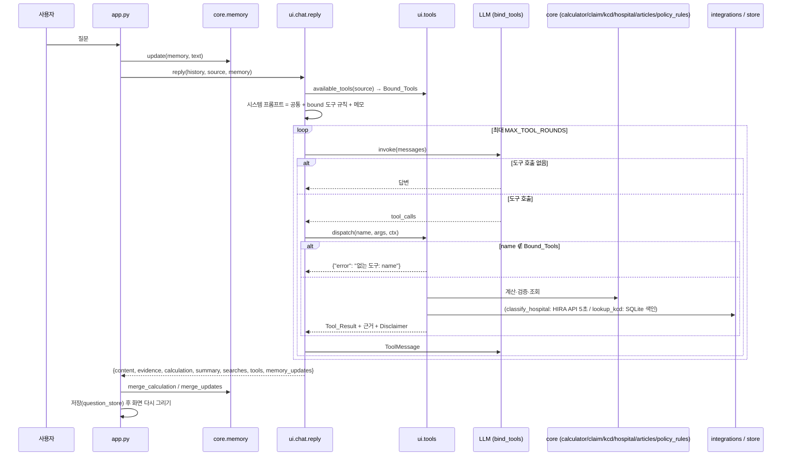
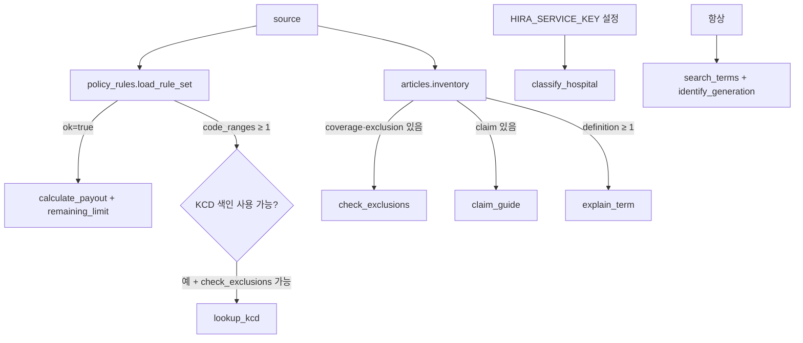
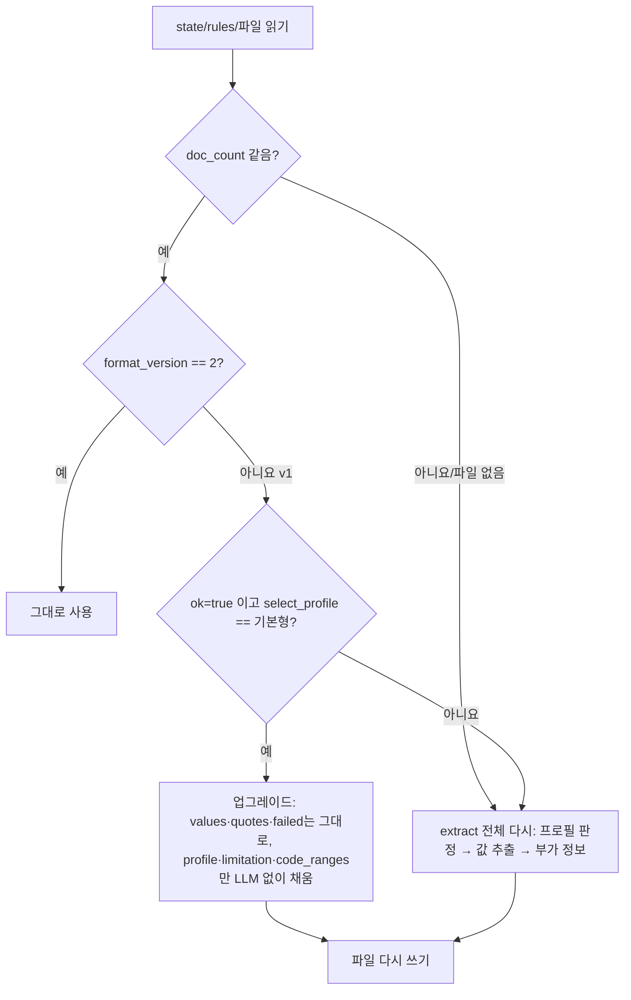

# Design Document: agent-tools-expansion

## Overview

채팅 에이전트(`boheom_mate/ui/chat.py`)가 쓰는 도구를 2개에서 9개로 늘리고, 간편가입 상품(25481)의 계산기를 켠다. 설계의 기준은 steering(`product`, `tech`, `structure`, `safety`)과 `common.md`이고, 원칙은 세 가지다.

1. **숫자·날짜는 코드가 만든다.** 공제액·한도·기한·세대·질병코드 범위 판정은 모두 `core/`의 순수 함수가 계산한다. LLM은 인자를 모으고 결과를 쉬운 말로 옮기기만 한다.
2. **약관 값은 원문 인용으로 검증한 것만 쓴다.** 간편가입 계산 값, 면책 3항목, 소멸시효 기간, 면책 질병코드 범위를 모두 Rule_Set에 넣고 인용문으로 검증한다. 검증하지 못한 값을 쓰는 도구는 bind하지 않는다.
3. **기존 동작을 깨지 않는다.** 기본형(25478)의 Rule_Set 값 22/22, `calculator.calculate`, `tests/test_calculator.py`, 기존 채팅 11턴, RAG 평가 거절 100%·검색 94%를 그대로 유지한다.

### 확정한 설계 결정 (요약)

| 번호 | 결정 | 근거 |
|---|---|---|
| D1 | 도구 스키마·사용 가능 조건·실행 함수(얇은 어댑터)는 새 파일 `boheom_mate/ui/tools.py`에 둔다. `ui/chat.py`에는 프롬프트 조립과 도구 호출 루프만 남긴다 | 아래 "도구 위치 비교" |
| D2 | 계산·검증·조회 로직은 `core/`(신규 `articles.py`, `claim.py`, `kcd.py`, `hospital.py`, 기존 `calculator.py`·`policy_rules.py`·`memory.py` 확장). 외부 API 클라이언트는 `integrations/hira_hospital.py`. KCD 로컬 색인 읽기는 `store/kcd_index.py`, 색인 생성 명령은 `jobs/build_kcd_index.py` | structure.md 레이어 규칙 |
| D3 | 간편가입은 별도 함수 `calculator.calculate_simple`로 계산한다. 기존 `calculate`는 손대지 않는다. 도구 이름은 둘 다 `calculate_payout`이고 상품 프로필에 따라 스키마만 다르게 bind한다 | Req 2.11, 평가 문항의 도구 이름 유지 |
| D4 | Rule_Set에 `format_version: 2`, `profile`, `exclusion_items`, `limitation`, `code_ranges`를 더한다. 기존 v1 캐시는 기본형이면 `values`를 건드리지 않고 LLM 없이 새 칸만 채워 올린다(22/22 유지) | Req 1.6 |
| D5 | 소멸시효 기간과 면책 질병코드 범위는 LLM 없이 정규식으로 원문에서 뽑고, 같은 `_norm` 규칙으로 인용문 검증을 한다 | 결정적 결과, 비용 0, Req 6.3·10.3 |
| D6 | KCD 로컬 색인 형식은 SQLite(stdlib `sqlite3`, 읽기 전용 열기) | 아래 "KCD 색인 형식 비교" |
| D7 | `check_exclusions`는 Article_Locator로 보장·면책 조각을 따로 고른 뒤 `rag.answer(question, source, articles=...)`로 답한다. 근거 번호 검증을 그대로 재사용한다 | Req 4.5 |
| D8 | `lookup_kcd`는 실행 안에서 `check_exclusions`를 함께 돌려 결과에 넣는다(프롬프트에 기대지 않음) | Req 10.6을 코드로 보장 |
| D9 | Disclaimer 부착, 근거 병합, 오류 포착, 없는 도구 거절은 디스패처 한곳에서 한다 | Req 3.3~3.7을 한 함수로 검증 |
| D10 | 속성 테스트는 Hypothesis(`hypothesis==6.170.13`, 2026-10-30 `pip index` 기준 최신)로 하고 `requirements.txt`에 정확한 버전으로 고정한다. 현재 `.venv`에 설치되어 있지 않다 | tech.md 테스트 규칙 |

### 웹 확인 재시도 결과 (2026-10-30, 1회)

- G1·G2: 검색(`getHospBasisList clCd 종별코드 ...`)에서 관련 문서가 나오지 않았다. `https://opendata.hira.or.kr/`은 curl 8초 안에 연결되지 않았다(HTTP 000).
- G4: `https://www.hira.or.kr/`도 연결되지 않았다(HTTP 000).
- 따라서 G1·G2·G4는 **가정으로 남긴다.** 파라미터 이름·응답 필드·종별 코드표·상병마스터 열 이름은 각각 한 곳의 상수로 두고, 키·파일을 받은 뒤 스모크 테스트(`tests/smoke_hira_hospital.py`, `jobs/build_kcd_index.py --check`)로 확정한다. 확정한 출처는 이 문서의 "외부 출처 확정 기록" 표에 적는다(Req 9.9).

참고 출처: [건강보험심사평가원_병원정보서비스](https://www.data.go.kr/data/15001698/openapi.do), [건강보험심사평가원_질병정보서비스](https://www.data.go.kr/data/15119055/openapi.do) (requirements.md "확인한 사실"에서 확인한 내용).

## Architecture

### 레이어 배치

```
boheom_mate/
├── app.py                    # (변경) 외부 전송 안내, memory_updates 반영
├── ui/
│   ├── chat.py               # (변경) 프롬프트 조립(bound 도구 규칙만) + 도구 호출 루프
│   ├── tools.py              # (신규) 9개 도구 스키마, 사용 가능 조건, 실행 어댑터, 디스패처
│   └── display.py            # (변경 없음)
├── core/
│   ├── articles.py           # (신규) Article_Locator: 구역+제목 메타데이터 조회, 조각 순위
│   ├── policy_rules.py       # (변경) 프로필(기본형/간편가입), 면책 3항목, 소멸시효, 코드 범위, v2 캐시
│   ├── calculator.py         # (변경) calculate_simple, remaining_limit 추가. calculate는 그대로
│   ├── claim.py              # (신규) 참고 기한 계산(치료일 + N년)
│   ├── kcd.py                # (신규) 질병코드 파싱, 범위 추출·분류, 범위 포함 판정
│   ├── hospital.py           # (신규) 종별 이름 → Calculator_Hospital 매핑
│   ├── memory.py             # (변경) 슬롯 4개 추가, merge_updates
│   └── glossary.py           # (필요할 때만 항목 추가)
├── store/
│   └── kcd_index.py          # (신규) SQLite 색인 생성·조회(읽기 전용)
├── integrations/
│   └── hira_hospital.py      # (신규) 병원정보서비스 클라이언트(requests, 5초)
└── jobs/
    └── build_kcd_index.py    # (신규) 상병마스터 CSV → data/kcd/kcd_index.sqlite3 (오프라인 일회성)
```

의존 방향: `app → ui → core/store/integrations`. `core`는 `ui`와 `integrations`를 import하지 않는다. `ui/tools.py`가 `integrations/hira_hospital.py`와 `store/kcd_index.py`를 호출해 결과를 `core` 순수 함수에 넘긴다.

### 도구 위치 비교 (D1)

| 안 | 장점 | 단점 | 판정 |
|---|---|---|---|
| A. `ui/chat.py`에 계속 둔다 | 파일 하나, 변경 최소 | 215줄 → 약 800줄. 스키마 9개·조건·어댑터·루프가 섞여 테스트 때 LLM 루프와 분리하기 어렵다 | 기각 |
| B. `ui/tools.py`로 분리 | 도구는 "LLM에 보여 주는 인터페이스"라 표현 계층(ui)에 맞다. `core`는 외부 I/O 최소 원칙을 지키고, `integrations` 호출을 ui가 조립한다. 디스패처를 LLM 없이 단위 테스트할 수 있다 | 파일 하나 추가 | **채택** |
| C. `core/tools.py`로 분리 | 다른 진입점(배치 등)에서 재사용 가능 | `core`가 `integrations`(외부 API)와 `store`를 import하게 되어 "core는 외부 I/O 최소" 원칙과 어긋난다. 재사용할 다른 진입점이 지금 없다(YAGNI) | 기각 |

`eval/run_chat.py`는 지금처럼 `boheom_mate.ui.chat`만 import한다. `chat.CALCULATOR_SOURCE`, `chat.calculator_available`, `chat.PLAIN_LANGUAGE`, `chat.reply`의 이름과 인자는 유지한다.

### 한 턴의 호출 흐름



### 사용 가능 조건 판정 흐름



## Components and Interfaces

### 1. Article_Locator (`core/articles.py`)

조항을 번호가 아니라 구역(`section`) + 제목(`title`) 메타데이터로 꺼낸다. 로컬 Chroma에서 확인한 위치는 다음과 같다(2026-10-30).

| 종류 | 제목(정확히 일치) | 기본형 25478 | 간편가입 25481 |
|---|---|---|---|
| COVERAGE | 보장종목별 보상내용 | 보통약관·특약1·특약2 제3조 (10/11/9조각) | 보통약관 제3조 (14) |
| EXCLUSION | 보상하지 않는 사항 | 보통약관·특약1·특약2 제4조 (15/39/46) | 보통약관 제4조 (55) |
| CLAIM | 보험금의 청구 | 보통약관 제7조 (1) | 보통약관 제6조 (1) |
| LIMITATION | 소멸시효 | 보통약관 제46조 (1) | 보통약관 제45조 (1) |
| DEFINITION | 용어의 정의 | 보통약관 제2조, 특약1·2 제2조, 별표 | 보통약관 제2조, 별표 |

- 제목은 **완전 일치**로 거른다. "지정대리청구인에 의한 보험금의 청구"(제42조·제41조)와 "제도성 특약: 대리청구인 지정 서비스 제3조 보험금의 청구"는 Claim_Article이 아니다.
- 구역은 `보통약관`과 `특별약관`으로 시작하는 구역만 쓴다. DEFINITION만 `별표: 용어의 정의`를 더한다. `제도성 특약`, `안내자료`, `관련 법규`는 뺀다.

```python
COVERAGE, EXCLUSION, CLAIM, LIMITATION, DEFINITION = (
    "보장종목별 보상내용", "보상하지 않는 사항", "보험금의 청구", "소멸시효", "용어의 정의")
KINDS = (COVERAGE, EXCLUSION, CLAIM, LIMITATION, DEFINITION)

def locate(source: str, title: str) -> list[dict]:
    """[{"id", "section", "article_no", "title", "text"}] (조각 id 순). 없으면 []."""

def inventory(source: str) -> dict[str, int]:
    """{제목: 조각 수}. 도구 사용 가능 조건 판정에 쓴다."""

def rank(question: str, chunks: list[dict], per_section: int) -> list[dict]:
    """질문 + glossary.lookup 용어로 kiwi 토큰(keyword_search.tokenize)을 만들고
    rank_bm25.BM25Okapi로 chunks 안에서만 순위를 매겨 구역마다 상위 per_section개."""
```

- `locate`는 `rag._collection().get(where={"$and": [{"source": source}, {"title": title}]})`로 한 번 읽고, 결과를 `(source, doc_count, title)` 키로 `lru_cache`한다. 약관을 다시 넣어 조각 수가 바뀌면 키가 바뀌어 새로 읽는다.
- `rank`는 임베딩을 부르지 않는다(비용·지연 0). 새 의존성은 없다(`rank-bm25`, `kiwipiepy`는 이미 있음).
- `policy_rules._articles_by_group`은 바꾸지 않는다. 기본형 22/22 추출 경로를 건드리지 않기 위해서다.

### 2. Rule_Extractor 확장 (`core/policy_rules.py`)

#### 2.1 프로필 레지스트리

```python
PROFILE_BASE, PROFILE_SIMPLE = "기본형", "간편가입"
FIELDS = {...}            # 기존 22개 그대로 (기본형)
ANCHORS = {...}           # 기존 그대로 + SIMPLE_ANCHORS 병합
SIMPLE_FIELDS = {...}     # 아래 표
ALL_FIELDS = {**FIELDS, **SIMPLE_FIELDS}   # verify()와 evidence()가 쓰는 조회표. 키 접두사 simple_로 겹치지 않음
PROFILES = {
    PROFILE_BASE:   {"fields": FIELDS, "groups": GROUPS, "must_exceed": MUST_EXCEED},
    PROFILE_SIMPLE: {"fields": SIMPLE_FIELDS, "groups": {"covered": "보통약관"},
                     "must_exceed": [("simple_inpatient_deduct", "simple_outpatient_deduct")]},
}
```

`verify(key, value, quote, article_text)`의 시그니처와 규칙은 그대로 두고, 내부의 `FIELDS[key]` 조회만 `ALL_FIELDS[key]`로 바꾼다. 기존 `tests/test_policy_rules.py`는 바뀌지 않고 통과해야 한다.

#### 2.2 간편가입 프로필 FIELDS·ANCHORS

모든 값은 보통약관(`covered`) 제3조에서 뽑는다. 숫자는 코드에 두지 않는다(Req 1.7). 오른쪽 "약관 값"은 설계 단계 확인 결과로, 테스트 기준값(`calculator.KB_SIMPLE_RULES`, 테스트 전용)에만 쓴다.

| 키 | 종류 | 필수 | 설명(LLM에 주는 문구) | ANCHORS | 약관 값 |
|---|---|---|---|---|---|
| `simple_inpatient_deduct` | won | 예 | 입원 공제금액 정액("○만원과 보장대상의료비의 ○% 중 큰 금액"의 정액) | 입원 | 100,000 |
| `simple_inpatient_rate` | deduct_rate | 예 | 입원 공제 비율 | 입원 | 0.3 |
| `simple_inpatient_annual_deduct_cap` | won | 예 | 입원 공제금액의 연간 합계 상한(초과분을 보상) | 초과, 연간, 계약해당일 | 2,000,000 |
| `simple_inpatient_case_cap` | won | 아니요 | 하나의 상해·질병당 보험가입금액 한도 | 보험가입금액, 하나의 | 50,000,000 |
| `simple_outpatient_deduct` | won | 예 | 통원 1회당 공제금액 정액 | 통원 | 20,000 |
| `simple_outpatient_rate` | deduct_rate | 예 | 통원 공제 비율 | 통원 | 0.3 |
| `simple_outpatient_per_visit_cap` | won | 예 | 통원 방문 1회당 보상 한도(보험가입금액) | 통원, 1회당 | 200,000 |
| `simple_outpatient_annual_visits` | count | 예 | 통원 연간 방문 한도 횟수 | 통원, 방문 | 180 |
| `simple_room_pay_rate` | pay_rate | 예 | 상급병실료 차액 보상 비율 | 병실 | 0.5 |
| `simple_room_daily_cap` | won | 예 | 상급병실료 차액 1일 평균 한도 | 병실 | 100,000 |
| `simple_no_nhis_pay_rate` | pay_rate | 예 | 국민건강보험을 적용받지 못한 경우 보상 비율 | 국민건강보험, 적용받지 | 0.4 |

- 추가 교차 검증 `must_exceed`: 입원 정액 > 통원 정액. 숫자는 맞지만 다른 항목을 인용하는 실수를 막는다(기존 `MUST_EXCEED`와 같은 방식).
- `pay_rate`의 숫자 표기는 기존 규칙대로 `40%`/`60%` 둘 다 인정한다. `simple_no_nhis_pay_rate`는 앵커가 "국민건강보험·적용받지"라 다른 비율과 섞일 위험이 낮다.
- 추출은 기존 `extract`의 3회 재시도 루프를 프로필의 `fields`·`groups`로 돌린다(`_extract_values(profile, groups)`로 루프만 함수로 뽑는다).

#### 2.3 구조 기반 프로필 선택 (Req 1.5)

```python
SIMPLE_STRUCTURE = re.compile(r"비급여.{0,120}?합한금액\(이하\W?보장대상의료비")

def select_profile(groups: dict) -> tuple[str | None, str]:
    """(프로필, 판정 이유). 상품코드·파일명을 보지 않는다."""
    if {"covered", "severe", "non_severe"} <= groups.keys():
        return PROFILE_BASE, "보통약관·중증·비중증 비급여 특약 제3조가 모두 있음"
    if groups.keys() == {"covered"} and SIMPLE_STRUCTURE.search(_norm(groups["covered"]["text"])):
        return PROFILE_SIMPLE, "비급여 특약 없이 보통약관 제3조가 급여+비급여를 보장대상의료비로 합산"
    return None, "약관 구조를 판별하지 못함"
```

- `groups`는 기존 `_articles_by_group(source)` 결과다(구역 판별 `_group_of`도 그대로).
- 판정 근거 문구(`SIMPLE_STRUCTURE`가 찾은 원문 구간)를 `profile_basis`로 저장해 화면 근거로 보여 줄 수 있게 한다.
- 프로필이 None이면 `ok=false`, `failed["profile"]`에 이유를 적는다. 같은 구조의 다른 상품(다이렉트간편 25488 등)은 검증을 통과하면 자동으로 계산기가 켜진다(Out of Scope에 적힌 대로).

#### 2.4 간편가입 면책 3항목 검증 (Req 1.8)

`select_profile`이 간편가입이면 보통약관 Exclusion_Article(`articles.locate(source, EXCLUSION)` 중 `section == "보통약관"`) 전체 원문으로 세 항목을 검증한다.

```python
SIMPLE_EXCLUSION_ITEMS = {
    # 키: (LLM에 주는 설명, 인용문에 모두 있어야 하는 말, 인용문에 하나 이상 있어야 하는 말)
    "manual_therapy": ("도수치료·체외충격파치료·증식치료로 생긴 비급여 의료비를 보상하지 않는다는 구절",
                       ["비급여"], ["도수치료", "체외충격파", "증식치료"]),
    "injection":      ("비급여 주사료를 보상하지 않는다는 구절(항암제·항생제·희귀의약품 예외 포함)",
                       ["주사료", "항암제"], ["비급여"]),
    "mri":            ("자기공명영상진단(MRI/MRA)으로 생긴 비급여 의료비를 보상하지 않는다는 구절",
                       ["비급여"], ["자기공명영상진단", "MRI", "MRA"]),
}

def verify_exclusion_item(key, quote, exclusion_text) -> str | None:
    """None이면 통과. 규칙: quote가 원문(_norm 기준)에 있음, 필수 말 모두 포함, 선택 말 하나 이상 포함,
    quote 앞뒤 ANCHOR_WINDOW자 안에 '보상하지' 포함."""
```

- LLM은 세 키마다 `{"quote": 원문 구절}`만 돌려준다(숫자 없음). 기존 `_ask`와 같은 3회 재시도.
- 셋 중 하나라도 실패하면 `ok=false`이고 `failed["exclusion_item:<키>"]`에 이유를 적는다.
- 통과한 인용문은 `exclusion_items[키] = {"quote", "meta": {"section": "보통약관", "article_no": "제4조", "title": "보상하지 않는 사항"}}`로 저장한다. `calculate_simple`이 0원 항목의 notes와 근거에 쓴다.

#### 2.5 소멸시효 기간 추출·검증 (Req 6.3)

```python
LIMITATION_PATTERN = re.compile(r"(\d{1,2})년간행사하지(?:않|아니하)(?:으면|면)소멸시효")

def extract_limitation(limitation_chunks) -> dict:
    """{"years": int|None, "quote": str|None, "meta": {...}|None, "failed": str|None}"""
```

1. Limitation_Article 조각을 합친 원문에서 문장 단위(줄바꿈과 "다." 기준)로 나눈다.
2. `_norm(문장)`에 `LIMITATION_PATTERN`이 맞는 첫 문장을 인용문으로, 그 숫자를 `years`로 한다.
3. 검증: 인용문이 원문에 있음(`_norm` 기준), 인용문에 `f"{years}년"`이 있음, 인용문에 "소멸시효"와 "청구권"이 있음, `1 ≤ years ≤ 10`. 하나라도 어기면 `years=None`과 이유.
4. 기산점 문구("청구권을 행사할 수 있는 때부터 진행")는 같은 조각에 있으면 `basis_quote`로 함께 저장해 `deadline_note`의 근거로 쓴다. 기간 숫자 3년은 코드에 두지 않는다(G5).

#### 2.6 면책 질병코드 범위 추출 (Req 10.3, 10.11)

`core/kcd.py`의 순수 함수로 구현하고, `policy_rules`는 Exclusion_Article 조각을 넘겨 결과를 Rule_Set에 저장만 한다. 모든 구역(보통약관 + 특별약관)의 Exclusion_Article을 훑는다.

```python
CODE = r"[A-Z]\d{2}(?:\.\d{1,2})?"
TILDES = "~∼～"                         # U+007E, U+223C, U+FF5E
RANGE_RE = re.compile(rf"({CODE})\s*[{TILDES}]\s*({CODE})")
SINGLE_RE = re.compile(rf"(?<![A-Z0-9.])({CODE})(?![\d.]|\s*[{TILDES}])")

def extract_ranges(chunk: dict) -> list[dict]:
    """한 조각에서 범위와 단일 코드를 모두 찾는다. 범위의 두 끝점은 단일 코드로 다시 세지 않는다."""

def classify(chunk_text: str, start: int, end: int) -> tuple[str, str | None]:
    """(kind, condition). kind는 "excluded" | "exception"."""
```

분류 규칙(결정적):

1. **항목 경계**: 코드 위치가 속한 항목을 고른다. 항목은 줄 머리의 번호 표지(`^\s*(\d+\.|[①-⑳]|[가-하]\.|\(\d+\))`) 사이 구간이다. E6에서 면책 조항을 항목 단위로 잘라 두었으므로 대부분 조각 하나가 항목 하나다.
2. **예외(exception)**: 같은 항목 안에서 (a) 코드 앞에 "다만"이 있고 코드 뒤에 "보상합니다"가 있거나, (b) 코드가 괄호 `( … )` 안에 있고 그 괄호 내용에 "보상합니다"가 있으면 `exception`. 확인한 예: F04∼F09·F20∼F29·F30∼F39·F40∼F48·F51·F90∼F98("다만, … 요양급여에 해당하는 의료비는 보상합니다"), Q82.5·G47.3(괄호 안 "보상합니다").
3. **그 밖**은 `excluded`.
4. **조건 문구(condition)**: 항목 원문(`_norm`)에 아래 표지가 있으면 그 이름을 붙인다. 없으면 None. 표지는 숫자가 아니라 문구라서 상수로 둔다.

   | 표지(_norm 기준) | condition |
   |---|---|
   | `요양급여에해당하지않는` | "요양급여에 해당하지 않는 부분만 면책" |
   | `요양급여에해당하는의료비는보상` | "요양급여 의료비는 보상" |
   | `비급여의료비` (excluded일 때) | "비급여 의료비만 면책" |

5. **인용문**: 코드가 들어 있는 문장(최대 300자)을 원문 그대로 `quote`로 저장한다. 검증은 "quote가 원문에 있음 + quote에 범위 표기(물결표 정규화 후)가 있음 + 같은 알파벳·시작 ≤ 끝". 실패한 범위는 `failed["code_range:<표기>@<구역>"]`로 남기고 `code_ranges`에 넣지 않는다.

`condition`은 화면·LLM 안내용 꼬리표이고, 판정은 항상 `quote` 원문을 함께 보여 주는 방식으로 한다. LLM이 꼬리표만 보고 단정하지 않게 Tool_Result에 `quote`를 같이 넣는다.

#### 2.7 Rule_Set 저장·불러오기와 v1 캐시 호환

```python
FORMAT_VERSION = 2

def load_rule_set(source) -> dict:
    """ok 여부와 관계없이 전체 Rule_Set(v2)을 돌려준다. claim_guide·lookup_kcd·도구 조건 판정용."""

def load(source) -> dict | None:
    """기존과 같음: ok=true인 Rule_Set만, 아니면 None. 내부에서 load_rule_set을 쓴다."""
```

`load_rule_set`의 판단 순서:



- 기본형 v1 캐시(ok, 22/22)는 업그레이드 경로를 타므로 `values`가 바뀌지 않는다. 테스트: v1 파일을 임시 폴더에 복사해 `load_rule_set`을 부른 뒤 `values == 이전 values`와 22개 모두 `KB_BASE_RULES`와 같음을 확인한다.
- 간편가입 v1 캐시(ok=false, 2개 값)는 다시 추출한다.
- 업그레이드·재추출 모두 `RULES_DIR`에 같은 파일 이름으로 쓴다. `state/`는 git과 `push.sh`에서 이미 빠져 있다.
- `evidence(rules, used_keys)`는 `ALL_FIELDS`로 그룹을 찾고, `exclusion:<키>` 형태의 키가 오면 `exclusion_items`의 인용문을 근거로 만든다.

### 3. 계산기 (`core/calculator.py`)

기존 `calculate`, `KB_BASE_RULES`, `_Rules`, `_item`은 그대로 둔다. 새 함수 두 개와 테스트 기준값 하나를 더한다.

```python
KB_SIMPLE_RULES = {...}   # 테스트 전용 기준값(2.2 표의 "약관 값"). 런타임 기본값으로 쓰지 않는다
DISCLAIMER = "실제 지급 여부와 금액은 보험사 심사로 확정됩니다."

def calculate_simple(care, covered_copay=0, non_covered=0, manual_therapy=0, injection=0, mri=0,
                     room_fee=0, room_days=0, visits=1, prior_deductible=None, prior_visits=0,
                     nhis_applied=True, hospital=None, generation=None, has_other_insurance=False,
                     *, rules, articles, exclusion_quotes) -> dict:
    """간편가입 프로필 계산. rules는 필수(기본값 없음). 반환 형식은 calculate와 같다:
    {"total", "items": [{label, amount, how, article}], "notes", "rules_used"}"""
```

입력 검증은 `calculate`와 같다(금액·일수 ≥ 0, `visits`는 1 이상 정수, `prior_deductible`·`prior_visits`는 None 또는 0 이상 정수, `generation` 보기). `rules`가 없으면 `ValueError`. 기본값으로 `KB_SIMPLE_RULES`를 쓰지 않는 이유는 검증되지 않은 값으로 계산하지 않기 위해서다(safety.md 금액 규칙).

#### 3.1 공식

기호: `r(키)`는 Verified_Value. `C`는 Covered_Medical_Cost = `covered_copay + non_covered`. `manual_therapy`·`injection`·`mri`·`room_fee`는 `C`에 넣지 않는다.

**입원**(`care == "입원"`)
```
fixed, rate = r(simple_inpatient_deduct), r(simple_inpatient_rate)
D      = min(C, max(fixed, C × rate))                 # 실제로 뗀 공제액(C보다 클 수 없음)
base   = C − D
prior  = prior_deductible or 0
cap    = r(simple_inpatient_annual_deduct_cap)
excess = max(0, min(D, prior + D − cap))              # 이번 공제액 중 연간 상한을 넘는 부분
pay    = base + excess
if not nhis_applied: pay = pay × r(simple_no_nhis_pay_rate)
case_cap = r.get(simple_inpatient_case_cap); if case_cap: pay = min(pay, case_cap) (+ notes)
```
- `prior_deductible`이 None이면 0으로 계산하고 notes에 "올해(계약해당일부터 1년) 이미 낸 입원 공제액이 있으면 연간 {cap}원 초과분이 더 보상될 수 있습니다"를 넣는다. `{cap}`은 Verified_Value를 `_cap_text`로 표시한다(Req 2.6).
- 상급병실료(`room_fee > 0`): `room_days ≤ 0`이면 `ValueError`. `room = min(room_fee × r(simple_room_pay_rate), r(simple_room_daily_cap) × room_days)`를 별도 항목으로 더한다(Req 2.4).

**통원**(`care == "통원"`)
```
fixed, rate, per_cap = r(simple_outpatient_deduct), r(simple_outpatient_rate), r(simple_outpatient_per_visit_cap)
per   = C / visits
D     = max(fixed, per × rate)
paid1 = clamp(per − D, 0, per_cap)                    # 방문 1회 보상액
if not nhis_applied: paid1 = clamp((per − D) × r(simple_no_nhis_pay_rate), 0, per_cap)
limit = r(simple_outpatient_annual_visits)
count = min(visits, max(0, limit − prior_visits))
pay   = paid1 × count
if count < visits: notes += f"연간 방문 한도 {limit}회를 넘은 {visits − count}회는 보상하지 않았습니다"
```
- 통원에는 연간 공제 상한·병원 종류 구분이 없다(약관 확인 사실).
- 처방조제비는 이 상품에서 보상하지 않으므로 스키마 설명에 "약값(처방조제비)은 넣지 않는다"를 적는다.

**면책 3항목**(Req 2.12): `manual_therapy`·`injection`·`mri` 중 0보다 큰 값마다 `_item(label, 0, "이 상품은 보상하지 않는 항목", "보통약관 제4조 (보상하지 않는 사항)")`을 더하고, notes에 `exclusion_quotes[키]` 원문과 "항암제·항생제·희귀의약품 주사는 보상되므로 일반 비급여로 알려 주세요"를 넣는다. `rules_used`에 `exclusion:<키>`를 넣어 근거로 보이게 한다.

**병원 종류**(Req 2.7): `hospital`이 주어지면 공제에 쓰지 않고 notes에 "이 상품은 병원 종류에 따라 공제금액이 달라지지 않습니다"를 넣는다.

**공통 notes**(Req 11.2): 기존 `calculate`와 같은 세대 경고(`generation`)·비례보상(`has_other_insurance`)·면책·연간 한도·기수령액 안내 문구를 같은 함수(`_common_notes`)로 넣는다. 문구 끝에 `DISCLAIMER`가 들어간다. 이 함수 추출은 `calculate`의 출력 문자열을 바꾸지 않는 범위에서만 한다(바뀌면 `calculate`에는 적용하지 않는다).

#### 3.2 남은 한도 (`remaining_limit`)

```python
def remaining_limit(profile, rules, received=None, prior_deductible=None, prior_visits=None) -> dict:
    """{"items": [{"label", "limit", "used", "remaining", "unit", "key"}], "notes": [...], "rules_used": [...]}
    remaining = max(0, limit − used) 또는 None(한도 미검증)."""
```

| 프로필 | 항목 | 한도 키 | 사용량 |
|---|---|---|---|
| 간편가입 | 연간 입원 공제 상한까지 남은 공제액 | `simple_inpatient_annual_deduct_cap` | `prior_deductible` |
| 간편가입 | 남은 통원 방문 횟수 | `simple_outpatient_annual_visits` | `prior_visits` |
| 간편가입 | 같은 상해·질병의 남은 가입금액(참고) | `simple_inpatient_case_cap`(선택) | `received` |
| 기본형 | 비중증 비급여 통원 남은 일수 | `non_severe_outpatient_annual_days`(선택) | `prior_visits` |
| 기본형 | 3대 비급여 연간 한도(도수·주사·MRI) | `severe_*_annual_cap`, `non_severe_mri_annual_cap` | 항목별 기수령액이 메모에 없어 `remaining=None`, notes에 "항목별로 받은 금액을 알아야 계산할 수 있음" |

- 한도 값이 Verified_Value가 아니면 `limit`·`remaining`을 None으로 두고 notes에 "약관에서 한도를 확인하지 못함"(Req 8.5).
- `used`가 None이면 그 항목의 `remaining`도 None이다(추정하지 않음).

### 4. 참고 기한 (`core/claim.py`)

```python
def reference_deadline(treatment_date: date, years: int) -> date:
    """치료일 + years년. 2월 29일이고 대상 연도가 윤년이 아니면 2월 28일."""
    target = treatment_date.year + years
    day = treatment_date.day
    if treatment_date.month == 2 and day == 29 and not calendar.isleap(target):
        day = 28
    return date(target, treatment_date.month, day)

def parse_date(text: str) -> date:
    """"YYYY-MM-DD"만 받는다. 형식·달력 오류는 ValueError."""
```

`DEADLINE_NOTE` 상수: "치료일 기준으로 계산한 참고 날짜입니다. 약관상 소멸시효는 청구권을 행사할 수 있는 때부터 진행하므로 실제 기산일은 사안마다 다를 수 있고, 실제 판단은 보험사 심사로 확정됩니다"(Req 6.6).

### 5. 질병코드 (`core/kcd.py`)

```python
def parse_code(text) -> tuple[str, int, str] | None:
    """"N39.3" → ("N", 39, "3"), "F32" → ("F", 32, ""). 공백·소문자 정리, 점 없는 4~5자("N393")는 3자 뒤에 점을 넣는다."""

def in_range(code, rng) -> bool:
    """rng = {"start", "end"}(단일 코드면 start == end).
    1) 알파벳이 같아야 한다. 2) 앞 두 자리 정수 n이 start_n ≤ n ≤ end_n.
    3) 끝점에 소수점 이하가 있으면 그 끝점과 n이 같을 때만 소수점 이하를 끝점의 자릿수로 잘라 문자열 비교한다
       (코드의 소수 자릿수가 끝점보다 짧으면 그 끝점 쪽은 불일치)."""

def match(candidates, code_ranges) -> list[dict]:
    """후보 코드마다 포함된 범위 목록과 요약 kind_summary:
    "excluded" | "exception" | "excluded_with_exception"(둘 다 걸림)."""
```

`kind_summary`가 `exception`이면 "면책 예외(보상 가능성 있음)", `excluded_with_exception`이면 "면책 범위이지만 예외 조건에 해당하면 보상"으로 표시한다(Req 10.11). 예: F32(우울증)는 F04∼F99(면책)와 F30∼F39(예외: 요양급여 의료비는 보상)에 함께 든다.

### 6. 병원 종류 (`core/hospital.py`, `integrations/hira_hospital.py`)

```python
# core/hospital.py
GENERAL_CLASSES = ("상급종합병원", "종합병원")
def to_calculator_hospital(class_name: str) -> str:
    """공백 제거 후 GENERAL_CLASSES 중 하나와 같거나 '종합병원'으로 끝나면 "종합병원", 그 밖(빈 문자열 포함)은 "의원"."""
```

```python
# integrations/hira_hospital.py — G1·G2 가정값을 이 파일 한 곳에 모은다
ENDPOINT = "https://apis.data.go.kr/B551182/hospInfoServicev2/getHospBasisList"
TIMEOUT_SECONDS = 5
ENV_KEY = "HIRA_SERVICE_KEY"
PARAMS = {"key": "ServiceKey", "name": "yadmNm", "rows": "numOfRows", "page": "pageNo", "type": "_type"}  # G1 가정
RESPONSE = {"name": "yadmNm", "class_code": "clCd", "class_name": "clCdNm", "addr": "addr"}            # G1 가정
CLASS_CODES = {"01": "상급종합병원", "11": "종합병원", "21": "병원", "28": "요양병원", "31": "의원",
               "41": "치과병원", "51": "치과의원", "92": "한방병원", "93": "한의원"}                  # G2 가정, clCdNm이 없을 때만 씀
ROWS = 10      # 후보는 최대 5개만 돌려주되, 총 건수(totalCount)로 "정확히 1건"을 판단한다
SOURCE_NOTE = "건강보험심사평가원 병원정보서비스(공공누리 제1유형)"

class HiraError(Exception): """키 없음·시간 초과·오류 응답·형식 오류. 메시지에 키나 URL을 넣지 않는다."""

def has_key() -> bool
def search(name: str) -> dict:  # {"total": int, "items": [{"name", "class_name", "addr"}]}
```

- 요청 파라미터는 `PARAMS`의 다섯 개뿐이다. 값은 병원 이름, 서비스키, `ROWS`, 1, `"json"`(Req 9.2).
- 응답: `_type=json` 결과를 먼저 파싱하고, 본문이 XML이면 `xml.etree.ElementTree`(stdlib)로 같은 필드를 읽는다(G1에서 정상 응답 JSON 지원 미확인). 오류 판정은 `OpenAPI_ServiceResponse.cmmMsgHeader.returnReasonCode` 존재, 또는 `response.header.resultCode != "00"`.
- `items.item`이 한 건이면 dict, 여러 건이면 list로 오는 공공데이터포털 관례를 둘 다 처리한다.
- **키 보호**: `requests` 예외 메시지에는 URL(키 포함)이 들어가므로 예외를 그대로 문자열로 만들지 않는다. `HiraError("시간 초과")`, `HiraError("오류 응답 코드 20")`처럼 고정 문구로 바꾼다. 로그를 남기지 않는다(Req 9.6).
- `.env.example`에 `HIRA_SERVICE_KEY=` 한 줄과 주석("공공데이터포털 개발계정 키, 병원정보서비스 15001698")을 더한다.

### 7. KCD 로컬 색인 (`store/kcd_index.py`, `jobs/build_kcd_index.py`)

#### KCD 색인 형식 비교 (D6)

| 형식 | 장점 | 단점 | 판정 |
|---|---|---|---|
| SQLite 파일 | stdlib, 이미 `questions.db`로 쓰는 방식. 읽기 전용(`mode=ro`)으로 열어 프로세스마다 메모리에 올리지 않는다(t3.micro 1GB). `LIKE`·색인으로 접두·포함 검색 | 내용을 눈으로 diff하기 어렵다 | **채택** |
| JSON 파일 | 가장 단순, 사람이 읽기 쉬움 | 수만 행을 Streamlit 프로세스마다 통째로 올림, 조회마다 선형 탐색 | 기각 |
| CSV 원본 직접 조회 | 생성 단계 없음 | 인코딩(CP949 가능성)·열 이름을 매 조회마다 처리, 느림 | 기각 |

#### 색인 생성 (오프라인 일회성, Req 10.12)

```
.venv/bin/python -m boheom_mate.jobs.build_kcd_index data/kcd/<상병마스터>.csv \
    --downloaded 2026-11-XX --version "<파일 버전>" --license "<운영자가 확인한 이용 조건>"
.venv/bin/python -m boheom_mate.jobs.build_kcd_index --check      # 색인 요약·샘플 조회(스모크)
```

- 입력은 CSV(UTF-8 또는 CP949 자동 판별)만 받는다. 원본이 xlsx면 운영자가 엑셀에서 CSV로 저장한다. `openpyxl` 같은 새 의존성을 피하기 위해서다.
- 열 이름은 `KCD_COLUMNS = {"code": "상병기호", "name_ko": "한글명", "name_en": "영문명"}`(G4 가정) 한 곳에 둔다. 열이 없으면 실제 열 목록을 출력하고 멈춘다.
- `--license`는 필수다. 운영자가 hira.or.kr 자료실에서 이용 조건을 확인한 뒤에만 색인을 만들 수 있게 한다(G4).
- 출력: `data/kcd/kcd_index.sqlite3`. `.gitignore`에 `data/kcd/`를 더한다. `deploy/push.sh`는 이미 `data/`를 제외한다.

#### 조회

```python
INDEX_PATH = ingest.BASE_DIR / "data" / "kcd" / "kcd_index.sqlite3"

def available() -> bool                       # 파일이 있고 읽기 전용으로 열리며 meta에 license가 있음
def lookup(text: str, limit=5) -> list[dict]  # [{"code", "name_ko"}]
def source_note() -> str                      # "건강보험심사평가원 상병마스터(KCD 기반), 받은 날짜 …, 버전 …, 이용 조건 …"
```

- `text`가 코드 모양(`parse_code`가 성공)이면 코드 접두 일치로 찾는다.
- 아니면 공백을 지운 한글명으로 찾고 순위는 완전 일치 → 접두 일치 → 포함 일치, 같은 등급이면 이름이 짧은 순 → 코드 순.
- 병명은 이 함수 밖으로 나가지 않는다. 외부 호출이 없다(Req 10.1).
- 대체 경로(질병정보서비스 API, G3)는 같은 `lookup` 계약을 지키는 `integrations/hira_disease.py`로 둔다. G4에서 파일을 쓸 수 없다고 확인된 경우에만 구현한다. 그때 요청 파라미터는 병명·서비스키·페이지뿐이고 제한 시간 5초(Req 10.7), 화면 안내에 "병명"을 넣는다(Req 11.3).

### 8. 도구 레지스트리와 디스패처 (`ui/tools.py`)

```python
@dataclass
class Tool:
    name: str
    schema: dict                         # OpenAI function 스키마
    rules: str                           # 시스템 프롬프트에 넣을 이 도구의 사용 규칙
    available: Callable[[Ctx], bool]
    run: Callable[[dict, Ctx], dict]     # Tool_Result(dict)를 돌려준다. 근거는 ctx.add_evidence로
    disclaimer: bool                     # True면 디스패처가 Tool_Result에 DISCLAIMER를 붙인다

@dataclass
class Ctx:
    source: str
    rule_set: dict                       # policy_rules.load_rule_set(source)
    inventory: dict                      # articles.inventory(source)
    memory: dict | None
    turn: dict                           # {"evidence", "calculation", "summary", "searches", "tools", "memory_updates"}
    def add_evidence(self, items): ...   # (section, article_no, title, text) 기준 중복 제거 후 turn["evidence"]에 추가

def bound_tools(ctx) -> list[Tool]            # REGISTRY 순서대로 available인 것만
def dispatch(name, args, bound, ctx) -> dict  # 아래 규칙
```

`dispatch` 규칙:
1. `name`이 `bound`에 없으면 실행하지 않고 `{"error": f"없는 도구: {name}"}`(Req 3.3).
2. `turn["tools"].append(name)`(호출 순서대로, Req 3.6).
3. `run` 실행. `ValueError`, `TypeError`, `HiraError`, `sqlite3.Error`를 잡아 `{"error": 메시지}`로 돌려준다(Req 3.7). 메시지는 예외 문자열이되, `HiraError`는 고정 문구만 갖는다.
4. `tool.disclaimer`면 결과에 `"disclaimer": DISCLAIMER`를 넣는다(오류 결과에도 넣는다, Req 3.4·11.1).
5. 결과 JSON에서 근거 원문 전체는 LLM에 다시 보내지 않고, 라벨(`"보통약관 제4조 보상하지 않는 사항"`)과 필요한 짧은 인용만 넣는다(프롬프트 길이 관리).

Evidence_List 항목은 기존 형식 `{"section", "article_no", "title", "text", "highlights"}`를 그대로 쓴다(Req 3.5). `display.group_evidence`가 같은 조항끼리 묶어 보여 준다.

### 9. 도구 9개 명세

공통: `source`는 인자로 받지 않고 `Ctx.source`를 쓴다. "근거" 열은 `ctx.add_evidence`로 Evidence_List에 넣는 것이다.

#### 9.1 `search_terms` (기존, 변경 없음)
- 스키마: `{"question": string}` 필수. 실행: `rag.answer(question, source)`. 조건: 항상.
- Tool_Result: `{"found", "answer", "evidence": [라벨]}`. 근거: `rag.answer`의 검증된 근거. Disclaimer: 없음(기존 유지).

#### 9.2 `calculate_payout` (기존 + 간편가입 스키마)
- 조건: `rule_set.ok`(Req 3.2).
- 스키마: 프로필이 기본형이면 기존 `CALCULATE_TOOL` 그대로. 간편가입이면 `CALCULATE_SIMPLE_TOOL`:

```json
{"name": "calculate_payout",
 "description": "영수증 금액으로 예상 실손 보험금을 계산한다(간편가입 약관 제3조 공식).",
 "parameters": {"type": "object", "required": ["care"], "properties": {
   "care": {"type": "string", "enum": ["통원", "입원"]},
   "covered_copay": {"type": "integer", "description": "급여 본인부담금(원). 없으면 0"},
   "non_covered": {"type": "integer", "description": "비급여(원) 중 도수치료·주사·MRI·병실료를 뺀 나머지. 약값(처방조제비)은 넣지 않는다"},
   "manual_therapy": {"type": "integer", "description": "비급여 도수치료·체외충격파·증식치료(원)"},
   "injection": {"type": "integer", "description": "비급여 주사(원). 항암제·항생제·희귀의약품 주사는 non_covered에 넣는다"},
   "mri": {"type": "integer", "description": "비급여 MRI/MRA(원)"},
   "room_fee": {"type": "integer"}, "room_days": {"type": "integer"},
   "visits": {"type": "integer", "description": "통원 방문 횟수. 모르면 1"},
   "prior_deductible": {"type": "integer", "description": "올해(계약해당일부터 1년) 이미 낸 입원 공제액. 사용자가 말했을 때만"},
   "nhis_applied": {"type": "boolean", "description": "국민건강보험을 적용받았는지. 적용받지 못했다고 말했을 때만 false"},
   "hospital": {"type": "string", "enum": ["의원", "종합병원"], "description": "이 상품은 공제에 쓰지 않는다. 말했으면 넣는다"},
   "generation": {"type": "string", "enum": ["1세대", "2세대", "3세대", "4세대"]},
   "has_other_insurance": {"type": "boolean"},
   "joined_year": {"type": "integer"}, "joined_month": {"type": "integer"}}}}
```

- 실행: 기존 `_run_calculate`를 옮기고 프로필에 따라 `calculate` 또는 `calculate_simple`을 부른다. 간편가입이면 `prior_deductible`이 인자에 없을 때 메모의 `deductible_this_year`, `prior_visits`는 메모의 `outpatient_visits_this_year`를 쓴다. 가입 연월 → 세대는 지금처럼 `memory.generation_of`.
- Tool_Result: 계산 결과에서 `rules_used`를 뺀 것(기존과 같음) + `disclaimer`. `turn["calculation"] = {**result, "inputs": inputs}`.
- 근거: `policy_rules.evidence(rule_set, result["rules_used"])`(면책 3항목 인용 포함).

#### 9.3 `check_exclusions`
- 스키마: `{"question": string}` 필수. 설명: "'이것도 보상돼요?'처럼 특정 치료·상황의 보상 여부를 물을 때. 보장 조항과 면책 조항을 함께 확인한다. 금액 질문에는 쓰지 않는다."
- 조건: `inventory`에 COVERAGE와 EXCLUSION이 모두 있음.
- 실행:
  1. `coverage = articles.rank(q, locate(COVERAGE), per_section=2)`, `exclusions = articles.rank(q, locate(EXCLUSION), per_section=3)`. 모든 보장 구역에서 고른다(Req 4.2).
  2. `result = rag.answer(q, source, articles=coverage + exclusions)`. 근거 번호·강조 문장 검증은 `rag.answer` 그대로(Req 4.5).
  3. `conclusive = bool(coverage) and bool(exclusions)`, `found = result["found"] and (coverage or exclusions)`.
- Tool_Result: `{"found", "conclusive", "answer", "coverage": [라벨], "exclusions": [라벨], "cited": [라벨], "disclaimer"}`. `found=false`면 `answer`는 `rag.NOT_FOUND_MESSAGE`.
- 근거: `result["evidence"]`(LLM이 실제로 인용하고 검증된 조각만).
- 프롬프트 규칙: "conclusive=false면 보상된다/안 된다를 단정하지 말고 확인한 쪽 조항만 안내", "found=false면 약관에서 확인할 수 없다고 말하기".

#### 9.4 `identify_generation`
- 스키마: `{"joined_year": integer(필수), "joined_month": integer}`. 조건: 항상.
- 실행: `g = memory.generation_of(year, month)`.
  - `g is None`: 연도가 1990~2100 밖이거나 정수가 아니면 `need="joined_year"`, 아니면(경계 연도에 월 없음) `need="joined_month"`.
  - `g in ("1세대","2세대","3세대")`: `warning` = Req 5.3 문구.
  - `latest_rules`: `rule_set.ok`면 현재 상품 Verified_Value 중 자기부담·공제를 나타내는 키(기본형: `covered_inpatient_pay_rate`, `covered_outpatient_clinic_deduct`, `non_severe_inpatient_pay_rate`; 간편가입: `simple_inpatient_deduct`, `simple_inpatient_rate`, `simple_outpatient_deduct`)의 값과 인용문. 아니면 빈 목록. 1~3세대 숫자나 외부 설명은 넣지 않는다(Req 5.4).
  - `turn["memory_updates"].update({"joined_year", "joined_month", "generation"})`(Req 5.5).
- Tool_Result: `{"generation", "need", "warning", "latest_rules": [{"label", "value", "quote"}], "disclaimer"}`.
- 근거: `latest_rules`의 인용문(`policy_rules.evidence`).

#### 9.5 `claim_guide`
- 스키마: `{"treatment_date": string("YYYY-MM-DD")}` 선택. 설명: "보험금 청구 서류나 청구 기한을 물을 때. 사용자가 사고일·청구권 발생일을 말해도 치료일로 넣는다."
- 조건: `inventory`에 CLAIM이 있음.
- 실행:
  1. `documents = locate(CLAIM)`, `limitation = locate(LIMITATION)`. 둘 다 Evidence_List에 넣는다(Req 6.1·6.2). 강조 문장은 각각 "영수증"·"소멸시효" 문장 중 원문에 있는 것.
  2. `years = rule_set["limitation"]["years"]`(None 가능).
  3. `treatment_date` 없음 → `deadline=None`, `need="treatment_date"`. 있고 `years`가 있음 → `parse_date` 후 `reference_deadline`, `deadline_basis="치료일 기준 참고 날짜"`, `deadline_note=DEADLINE_NOTE`. `years`가 None → `deadline=None`, 원문만 안내(Req 6.5).
- Tool_Result: `{"documents_article": 원문(최대 1,500자), "limitation_article": 원문(최대 800자), "limitation_years", "deadline", "deadline_basis", "deadline_note", "need", "disclaimer"}`.

#### 9.6 `explain_term`
- 스키마: `{"term": string}` 필수. 설명: "약관 용어의 뜻을 물을 때(예: 비급여가 뭐예요?)."
- 조건: `inventory`의 DEFINITION ≥ 1.
- 실행:
  1. 후보 말 = `[term]` + `glossary.lookup(term)`의 용어에서 괄호를 뺀 2자 이상 낱말(순서 유지).
  2. DEFINITION 조각 중 후보 말이 `_norm` 기준으로 들어 있는 조각을 찾는다. 앞선 후보 말과 일치할수록, 정의 형태(`용어\s*[:：]`, `'용어'(이)?란`, `"용어"라 함은`)일수록 앞에 둔다. 상위 3개.
  3. 각 조각에서 후보 말이 든 문장을 원문 그대로 `highlights`로 고른다(원문에 있는 문장만, Req 7.3).
- Tool_Result: `{"found", "term", "matched_terms", "definitions": [{"label", "sentences"}]}`. 못 찾으면 `found=false`, 답변에 `rag.NOT_FOUND_MESSAGE`(Req 7.2).
- 근거: 찾은 정의 조각과 highlights.
- Glossary: 새 항목은 꼭 필요할 때만 더한다. 더하면 `tests/test_glossary.py`가 오른쪽 용어가 Chroma 원문에 있는지, `eval/questions.json`의 `answer_must_include`·`evidence_contains` 숫자 표현을 포함하지 않는지 확인한다(Req 7.4).

#### 9.7 `remaining_limit`
- 스키마: 인자 없음(`{"type": "object", "properties": {}}`). 설명: "올해 이미 받은 보험금·낸 공제액·방문 횟수를 반영해 남은 한도를 물을 때."
- 조건: `rule_set.ok`.
- 실행: 메모의 `received_this_year`, `deductible_this_year`, `outpatient_visits_this_year`, `anniversary_month/day`를 읽는다.
  - `received`와 `deductible`이 모두 None → 계산하지 않고 `need=["received_this_year", "deductible_this_year"]`(Req 8.6).
  - 그 밖 → `calculator.remaining_limit(profile, values, ...)`.
  - 계약해당일이 없으면 `warning` = Req 8.7 문구.
- Tool_Result: `{"items", "notes", "need", "warning", "disclaimer"}`.
- 근거: `policy_rules.evidence(rule_set, result["rules_used"])`.
- 왜 인자가 없는가: Req 8.3은 Session_Memory에서 읽도록 정했다. 앱은 `reply` 전에 같은 턴의 사용자 말로 메모를 갱신하므로 같은 턴에 말한 값도 들어온다.

#### 9.8 `classify_hospital`
- 스키마: `{"hospital_name": string}` 필수. 설명: "사용자가 병원 이름을 말했지만 의원/종합병원 구분을 모를 때만."
- 조건: `hira_hospital.has_key()`.
- 실행: `hira_hospital.search(name)`.
  - `HiraError`(키 없음·5초 초과·오류 코드) 또는 `total == 0` → `need="ask_hospital_type"`(Req 9.5).
  - `total == 1` → `calculator_hospital = hospital.to_calculator_hospital(class_name or CLASS_CODES.get(code, ""))`. 종별 이름과 코드가 모두 없으면 `need="ask_hospital_type"`.
  - `total ≥ 2` → `calculator_hospital=None`, `need="choose_candidate"`(Req 9.4).
- Tool_Result: `{"candidates": [{"name", "class_name", "addr"}] (최대 5), "calculator_hospital", "need", "source_note": SOURCE_NOTE}`.
- 근거: 약관 조항이 아니므로 Evidence_List에 넣지 않는다. 응답 원문은 메모에 저장하지 않는다(Req 11.4). 사용자가 확인해 계산에 쓴 `hospital`만 기존 `merge_calculation`으로 메모에 들어간다.

#### 9.9 `lookup_kcd`
- 스키마: `{"disease": string}` 필수. 설명: "사용자가 이번 대화에서 직접 말한 병명·질병코드의 면책 코드 범위를 대조할 때만. 병명을 먼저 묻지 않는다."
- 조건: `kcd_index.available()`, `rule_set["code_ranges"]` ≥ 1, `check_exclusions` 사용 가능.
- 실행:
  1. `candidates = kcd_index.lookup(disease)`. 0건이거나 `sqlite3.Error` → `found=false`.
  2. `matches = kcd.match(candidates, rule_set["code_ranges"])`. 매치마다 `{"code", "range", "kind", "condition", "section", "article_no", "quote"}`. 근거에 그 인용문을 넣는다(Req 10.4).
  3. `exclusions_check = check_exclusions.run({"question": f"{disease} 치료 보상 여부"}, ctx)`(D8, Req 10.6). 이 내부 호출은 `turn["tools"]`에 `check_exclusions`로도 기록한다.
- Tool_Result: `{"found", "candidates", "matches", "kind_summary", "exclusions_check", "warning": Req 10.5 문구, "source_note": kcd_index.source_note(), "disclaimer"}`.
- 프롬프트 규칙: "matches만으로 보상되지 않는다고 단정하지 않는다. exclusions_check와 함께 안내한다. exception은 면책으로 안내하지 않는다."

### 10. 시스템 프롬프트 (`ui/chat.py`)

```python
def _system_prompt(ctx, bound) -> str:
    return (HEADER                                   # "당신은 '보험메이트'…" 첫 줄
            + "".join(t.rules for t in bound)        # bound된 도구의 규칙만 (Req 3.8)
            + product_note(ctx)                      # 상품 구조 한 줄
            + SCOPE                                  # [범위]
            + (PLAIN_RULES if PLAIN_LANGUAGE else "")
            + session_memory.prompt_block(ctx.memory))
```

- `search_terms`·`calculate_payout`(기본형) 규칙 문구는 지금 `BASE_PROMPT`의 [약관 내용]·[금액 계산] 문단을 그대로 옮긴다. 기본형 상품에서 bound 도구가 두 개뿐이면 프롬프트가 지금과 같은 내용이 되도록 한다(회귀 기준).
- 지금 [약관 내용]의 "이 상품은 급여는 보통약관, 비급여는 특약1·2" 문장은 기본형에만 맞으므로 `product_note`로 옮긴다. 기본형: 기존 문장. 간편가입: "이 상품은 급여·비급여를 보통약관 한 담보에서 보상하고, 비급여 도수치료·주사·MRI는 보상하지 않습니다(제4조)." 프로필이 None이면 넣지 않는다.
- 계산기가 꺼진 상품의 `calculator_note`는 지금처럼 남긴다.
- [금액 계산]의 세대 경계 안내 문장은 `identify_generation`이 bound이면 "가입 시기를 말하면 identify_generation으로 세대를 확인하세요"로 바꾼다.
- 도구별 규칙은 "쓸 때 / 쓰지 말 때"를 한 줄씩 적어 선택 오류를 줄인다. 예: `check_exclusions`는 "금액 질문에는 쓰지 않는다", `classify_hospital`은 "병원 종류를 이미 말했으면 쓰지 않는다", `lookup_kcd`는 "사용자가 병명을 말하지 않았으면 쓰지 않는다".

### 11. 화면 (`app.py`)

- `chat.bound_tool_names(source)`를 새로 두고, `classify_hospital`이 들어 있으면 상품 선택 아래에 "병원 이름 조회는 외부 공공 API(건강보험심사평가원)로 전송됩니다."를 캡션으로 보인다(Req 11.3). `lookup_kcd`가 대체 API일 때만 "병원 이름과 병명 조회는…"으로 바꾼다.
- `reply` 결과의 `memory_updates`를 `session_memory.merge_updates`로 메모에 합친 뒤 저장한다(Req 5.5).
- 근거는 기존 `render_evidence`가 그대로 그린다. 간편가입 계산 결과도 `render_calculation`의 형식(`items`, `notes`)이 같아 그대로 쓴다. 0원 면책 항목이 표에 "0원"으로 보인다.
- 기존 첫 화면 안내("질문은 답변을 만들기 위해 OpenAI로 전송됩니다")는 유지한다.

### 12. 평가 확장 (`eval/run_chat.py`, `eval/conversations.json`)

현재 구조(시나리오 → 턴 → `check(expect, result)`)를 유지하고 키만 더한다.

| 키 | 위치 | 채점 |
|---|---|---|
| `tool` | expect | 이 턴의 `tools`에 이 이름이 있어야 한다 |
| `no_tool` | expect | 이 턴의 `tools`에 목록의 이름이 하나도 없어야 한다 |
| `source` | expect(턴), 또는 시나리오 | 그 상품으로 `chat.reply` 호출(Req 12.2). 없으면 `chat.CALCULATOR_SOURCE` |
| `answer_includes` | expect | 문자열 목록. 모두 답변에 있어야 한다(예: "영수증") |
| `evidence_title` | expect | 근거 중 이 제목(예: "보상하지 않는 사항", "용어의 정의")의 조각이 1개 이상 |
| `requires` | 턴 | `["hira_key"]` 또는 `["kcd_index"]`. 조건이 없는 환경이면 `expect_fallback`으로 채점 |
| `expect_fallback` | 턴 | 키·색인이 없을 때 기대값. 생략하면 `{"ask": true}`(Req 12.7) |
| `memory` | 시나리오 | true면 앱처럼 턴마다 `session_memory.update`를 부르고 `memory_updates`를 합친다 |
| `group` | 시나리오 | `"tools"`면 새 문항. 없으면 기존 문항(C01~C08) |

- `tools_called(result)`: `result.get("tools")`가 있으면 그것, 없으면 `calculation`이 있으면 `calculate_payout`, `searches`가 있으면 `search_terms`로 만든다. 그래서 바뀐 `run_chat.py`로 **바꾸기 전 코드**의 기준선(기존 11턴의 Tool_Selection_Error 수)을 먼저 잴 수 있다.
- 기존 문항의 암묵 기대: `calc`가 숫자 → `tool: calculate_payout`, `calc: null` → `no_tool: [calculate_payout]`, `search: true` → `tool: search_terms`. 이것으로 기존 11턴의 Tool_Selection_Error를 센다.
- Tool_Selection_Error는 턴 단위로 센다(한 턴에 여러 위반이 있어도 1).
- 결과 요약에 `tool_selection_errors`, `legacy_turn_pass`(기존 11턴), `legacy_tool_selection_errors`, `mode: {"hira_key": bool, "kcd_index": bool}`, `prompt_chars`(상품별 시스템 프롬프트 길이)를 더한다. 행(`rows`)에 `tools`와 `source`를 더한다.

추가할 문항(기대 총액은 약관 공식 손계산, 근거는 `name`과 `note` 필드에 적는다, Req 12.6):

| id | 도구 | 질문 | 기대 |
|---|---|---|---|
| C09 | check_exclusions | 임신 관련 진료도 실손 돼요? | tool, evidence_title "보상하지 않는 사항", no_tool [calculate_payout] |
| C10 | check_exclusions | 치과 임플란트 보상돼요? | 위와 같음 |
| C11 | identify_generation | 2015년 5월에 실손 가입했어요. 몇 세대예요? | tool, answer_includes ["2세대"], no_tool [calculate_payout] |
| C12 | claim_guide | ① 보험금 청구하려면 어떤 서류를 내야 해요? ② 2026년 3월 2일에 치료받았으면 언제까지 청구해야 해요? | ① tool, answer_includes ["영수증"] ② tool, answer_includes ["2029"] (치료일 + 약관 3년) |
| C13 | explain_term | 비급여가 무슨 뜻이에요? | tool, evidence_title "용어의 정의" |
| C14 | remaining_limit (간편가입, memory) | 올해 입원 공제로 이미 150만 원 냈어요. 연간 공제 한도까지 얼마 남았어요? | tool, answer_includes ["50만"] (200만 − 150만) |
| C15 | classify_hospital (requires hira_key) | 서울아산병원 외래에서 급여 본인부담금 3만 원 냈어요. 얼마 받아요? | tool, calc 10000 (상급종합 → 종합병원: max(20,000, 30,000×0.2)=20,000 공제 → 10,000). fallback: ask |
| C16 | lookup_kcd (requires kcd_index) | 우울증으로 정신건강의학과 다니는데 실손 돼요? | tool lookup_kcd, evidence_title "보상하지 않는 사항". fallback: {tool: check_exclusions, no_tool: [lookup_kcd]} |
| C17 | 간편가입 통원 | 간편가입인데 동네 의원 1번 가서 급여 본인부담금 1만 원, 비급여 5만 원 냈어요. 얼마 받아요? | calc 40000 (C=60,000, max(20,000, 18,000)=20,000 공제, 회당 한도 20만 이하) |
| C18 | 간편가입 입원 + 연간 상한 | ① 입원해서 급여 본인부담금 100만 원, 비급여 50만 원 냈어요. 1인실은 안 썼어요 ② 올해 다른 입원으로 공제금액 190만 원을 이미 냈어요 | ① calc 1050000 (C=1,500,000, max(100,000, 450,000)=450,000) ② calc 1400000 (190만+45만−200만=35만 초과분 추가) |
| C19 | 간편가입 면책 | 간편가입인데 비급여 도수치료 10만 원 받았어요. 얼마 받아요? | calc 0, not_covered true |

C14·C17~C19는 `source`를 간편가입 파일로 둔다.

## Data Models

### Rule_Set v2 (`state/rules/<source>.json`)

```json
{
  "format_version": 2,
  "source": "KB_간편가입실손의료비보장보험_26.09_약관.pdf",
  "doc_count": 356,
  "profile": "간편가입",
  "profile_basis": {"reason": "비급여 특약 없이 …", "quote": "… 합한 금액(이하 '보장대상의료비' …"},
  "ok": true,
  "values": {"simple_inpatient_deduct": 100000, "simple_inpatient_rate": 0.3, "...": "..."},
  "quotes": {"simple_inpatient_deduct": "10만원과 보장대상의료비의 30% 중 큰 금액", "...": "..."},
  "failed": {"exclusion_item:mri": "…(실패 시에만)"},
  "articles": {"covered": "보통약관 제3조 (보장종목별 보상내용)"},
  "evidence_meta": {"covered": {"section": "보통약관", "article_no": "제3조", "title": "보장종목별 보상내용"}},
  "exclusion_items": {
    "manual_therapy": {"quote": "…", "meta": {"section": "보통약관", "article_no": "제4조", "title": "보상하지 않는 사항"}},
    "injection": {"quote": "…", "meta": {"...": "..."}},
    "mri": {"quote": "…", "meta": {"...": "..."}}
  },
  "limitation": {"years": 3, "quote": "… 3년간 행사하지 않으면 소멸시효가 완성됩니다.", "basis_quote": "…",
                 "meta": {"section": "보통약관", "article_no": "제45조", "title": "소멸시효"}},
  "code_ranges": [
    {"start": "F04", "end": "F99", "kind": "excluded", "condition": null, "quote": "…",
     "section": "보통약관", "article_no": "제4조", "title": "보상하지 않는 사항"},
    {"start": "F30", "end": "F39", "kind": "exception", "condition": "요양급여 의료비는 보상", "quote": "…",
     "section": "보통약관", "article_no": "제4조", "title": "보상하지 않는 사항"},
    {"start": "N39.3", "end": "N39.3", "kind": "excluded", "condition": null, "quote": "…", "...": "..."}
  ]
}
```

- `ok`는 프로필 필수 값 전부 검증 + (간편가입이면) 면책 3항목 검증일 때만 true다. `limitation`과 `code_ranges`는 `ok`에 영향을 주지 않는다(계산과 무관한 도구가 따로 조건을 본다).
- 기본형 v2는 `profile: "기본형"`, `exclusion_items: {}`이고 `values`·`quotes`는 v1과 같다.

### Tool_Result 공통 형태

| 키 | 뜻 |
|---|---|
| `error` | 실행 실패 또는 없는 도구. 있으면 다른 키는 없을 수 있다 |
| `found` | 약관에서 근거를 찾았는지(`check_exclusions`, `explain_term`, `lookup_kcd`) |
| `need` | 되물어야 할 값 이름(문자열 또는 목록) |
| `warning` | 사용자에게 꼭 전할 경고 |
| `disclaimer` | `"실제 지급 여부와 금액은 보험사 심사로 확정됩니다."` |
| `source_note` | 외부 데이터 출처·이용 조건 |

### `reply` 반환값

```python
{"content": str, "evidence": [Evidence], "calculation": dict | None, "summary": str | None,
 "searches": [str], "tools": [str],            # 신규: 실행한 도구 이름(호출 순서)
 "memory_updates": dict}                       # 신규: 메모에 합칠 사실(identify_generation 등)
```

`question_store.add_message`의 인자는 바꾸지 않는다. `tools`와 `memory_updates`는 저장하지 않는다.

### Session_Memory 추가 칸 (`core/memory.py`)

| 칸 | 형식 | `clean` 규칙 | `describe` 줄 |
|---|---|---|---|
| `received_this_year` | int ≥ 0 또는 None | 정수(실수면 정수일 때만), 음수·bool 거부 | "올해 받은 보험금: 120,000원" |
| `deductible_this_year` | int ≥ 0 또는 None | 같음 | "올해 낸 입원 공제액: 1,500,000원" |
| `outpatient_visits_this_year` | int ≥ 0 또는 None | 같음, 1,000 이하 | "올해 통원 횟수: 12회" |
| `anniversary_month`, `anniversary_day` | int 또는 None | 둘 다 있고 유효한 월·일(2월 29일 허용)일 때만 둘 다 남김 | "계약해당일: 매년 3월 15일" |

- `EMPTY`와 `PROMPT`에 새 칸을 더한다. 프롬프트에 "사용자가 직접 말한 금액·횟수만, '올해'는 계약일부터 1년 기준임을 몰라도 사용자가 말한 대로 적는다"를 넣는다.
- `prompt_block`은 `describe`를 쓰므로 자동으로 새 줄이 들어간다.
- `merge_updates(memory, updates)`: `joined_year`, `joined_month`, `generation`, 새 4칸만 받아 `clean`을 거친다. 외부 API 응답·KCD 결과는 받는 칸이 없으므로 저장될 수 없다(Req 11.4).
- 삭제·보관 규칙은 기존과 같다: "새 대화"·"기억 지우기"에서 표 행 삭제, `MEMORY_TTL_HOURS`(24) 경과 시 `purge_old_memory`(Req 8.2). `question_store`는 바꿀 필요가 없다(메모를 JSON 통째로 저장).

### KCD 색인 (`data/kcd/kcd_index.sqlite3`)

```sql
CREATE TABLE kcd  (code TEXT PRIMARY KEY,     -- 정규화 "N39.3"
                   code_raw TEXT NOT NULL,     -- 원본 표기 "N393"
                   name_ko TEXT NOT NULL,
                   name_ko_norm TEXT NOT NULL, -- 공백 제거
                   name_en TEXT);
CREATE INDEX kcd_name ON kcd(name_ko_norm);
CREATE TABLE meta (key TEXT PRIMARY KEY, value TEXT NOT NULL);
-- meta: source_file, downloaded, version, license, built_at, row_count
```

### 외부 출처 확정 기록 (구현 중 채운다, Req 9.9)

| 항목 | 현재 값(가정) | 확인 방법 | 확인 결과·출처 |
|---|---|---|---|
| G1 요청 파라미터 | `ServiceKey`, `yadmNm`, `numOfRows`, `pageNo`, `_type` | 키 발급 후 `tests/smoke_hira_hospital.py`, 활용가이드 docx | 미확인 |
| G1 응답 필드·JSON | `yadmNm`, `clCd`, `clCdNm`, `addr`, JSON 정상 응답 | 위와 같음 | 오류 응답만 JSON 확인(2026-10-30) |
| G2 종별 코드표 | `CLASS_CODES` 9개 | opendata.hira.or.kr 코드조회, 스모크 응답의 `clCd`/`clCdNm` 쌍 | 미확인(2026-10-30 재시도 연결 실패) |
| G4 상병마스터 형식·이용 조건 | CSV, 열 `상병기호`/`한글명`/`영문명` | 운영자가 hira.or.kr 자료실에서 확인 | 미확인(2026-10-30 재시도 연결 실패) |

## Correctness Properties

*A property is a characteristic or behavior that should hold true across all valid executions of a system-essentially, a formal statement about what the system should do. Properties serve as the bridge between human-readable specifications and machine-verifiable correctness guarantees.*

requirements.md가 속성 테스트로 정한 9개 기준(2.9, 2.10, 2.13, 5.6, 6.7, 8.8, 8.9, 9.8, 10.9)과 1:1로 대응한다. 겹침 검토 결과: 2.10(낸 금액 증가)과 8.9(누적 공제 증가)는 바꾸는 입력이 달라 서로를 함의하지 않는다. 2.9(상한 불변식)와 2.13(면책 금액 무관성)도 독립이다. 그래서 9개를 모두 남긴다. 나머지 기준은 prework에서 EXAMPLE·EDGE_CASE·INTEGRATION으로 분류했고 Testing Strategy의 예제 테스트로 다룬다.

생성기 공통: 간편가입 rules는 `KB_SIMPLE_RULES`를 기준으로 하되 값의 범위를 넓혀 생성한다(정액 1~50만원, 비율 0.05~0.95, 연간 상한 10만~1,000만원, 회당 한도 1만~100만원, 방문 한도 1~365회, 미적용 비율 0.05~1). 금액은 0~5,000만원 정수, 방문 1~400회.

### Property 1: 간편가입 보상액 상한·하한

*For any* 간편가입 rules, 진료 형태(입원/통원), 0원 이상 급여 본인부담금·비급여·상급병실료(입원 일수 1 이상), 1 이상 방문 횟수, 0 이상 누적 공제액·기존 방문 횟수, 건강보험 적용 여부에서, `calculate_simple`의 `total`은 0 이상이고 `covered_copay + non_covered + manual_therapy + injection + mri + room_fee` 이하이며, 각 항목 `amount`도 0 이상이다.

**Validates: Requirements 2.9**

### Property 2: 낸 금액에 대한 단조성

*For any* 간편가입 계산 입력 x와, x에서 `covered_copay` 또는 `non_covered`(또는 `room_fee`) 하나만 0 이상 늘린 입력 x'에서, `calculate_simple(x').total ≥ calculate_simple(x).total`이다.

**Validates: Requirements 2.10**

### Property 3: 면책 3항목 금액의 무관성

*For any* 간편가입 계산 입력 x와, x에서 `manual_therapy`·`injection`·`mri` 값만 임의의 0 이상 정수로 바꾼 입력 x'에서, 두 결과의 `total`은 같다.

**Validates: Requirements 2.13**

### Property 4: 세대 판정은 `generation_of`와 같다 (모델 기반)

*For any* 1990~2100 정수 연도와 1~12 정수 월 또는 None에서, `identify_generation` 실행 결과의 `generation`은 `memory.generation_of(year, month)`와 같고, 그 값이 None이면 `need`가 `"joined_month"` 또는 `"joined_year"`이며 None이 아니면 `need`는 None이다.

**Validates: Requirements 5.6**

### Property 5: 참고 기한 불변식

*For any* 1990-01-01~2100-12-31 사이 날짜 d와 1~10 정수 n에서, `reference_deadline(d, n)`은 유효한 `date`이고, d보다 늦으며, 연도 차이가 정확히 n이고, 월은 d의 월과 같으며, 일은 d의 일과 같거나(d가 2월 29일이고 대상 연도가 평년일 때만) 28이다.

**Validates: Requirements 6.7**

### Property 6: 남은 한도의 범위

*For any* 프로필(기본형/간편가입)과 그 프로필 rules(선택 한도는 있거나 없음), 0 이상 또는 None인 기수령액·누적 공제액·방문 횟수에서, `remaining_limit`의 모든 항목은 `remaining`이 None이거나 `0 ≤ remaining ≤ limit`이고, `limit`이 None이면 `remaining`도 None이다.

**Validates: Requirements 8.8**

### Property 7: 누적 공제액에 대한 단조성

*For any* 간편가입 입원 계산 입력 x와, x에서 `prior_deductible`만 늘린 입력 x'(None은 0으로 본다)에서, `calculate_simple(x').total ≥ calculate_simple(x).total`이다.

**Validates: Requirements 8.9**

### Property 8: 병원 종류 매핑의 값 범위

*For any* 문자열 s(빈 문자열, 공백, 한글·영문·기호 포함, 실제 종별 이름 9종 포함)에서, `to_calculator_hospital(s)`는 `"의원"` 또는 `"종합병원"`이고, s가 공백을 지웠을 때 `"상급종합병원"` 또는 `"종합병원"`이면 `"종합병원"`이다. API는 목으로 대체한다.

**Validates: Requirements 9.8**

### Property 9: 질병코드 범위 포함 판정 (모델 기반)

*For any* 알파벳 1자 + 숫자 2자리(선택적으로 소수점 이하 1~2자리) 코드 c와, 같은 형식의 끝점으로 만든 범위 r(시작 ≤ 끝, 단일 코드 포함)에서, `kcd.in_range(c, r)`는 참조 모델과 같다. 참조 모델: 알파벳이 같고, 끝점의 소수점 이하를 무시한 정수 비교로 `start_n ≤ c_n ≤ end_n`이며, `c_n`이 소수점이 있는 끝점의 정수와 같으면 c의 소수 부분을 그 끝점 자릿수로 잘라 시작 쪽은 `≥`, 끝 쪽은 `≤`로 비교한다(c의 소수 자릿수가 끝점보다 짧으면 그 비교는 거짓). 생성기는 물결표 `~`와 `∼` 표기, 점 없는 표기("N393")를 섞어 `parse_code`를 함께 거친다.

**Validates: Requirements 10.9**

## Error Handling

| 상황 | 처리 | 사용자에게 보이는 것 |
|---|---|---|
| LLM이 Bound_Tools 밖 이름 호출 | 실행 안 함, `{"error": "없는 도구: …"}` | LLM이 다른 방법으로 답함 |
| 도구 인자 형식 오류(`ValueError`/`TypeError`) | `{"error": 메시지}` + 대상 도구면 Disclaimer | LLM이 고쳐 다시 부르거나 되물음 |
| Rule_Set `ok=false` | `calculate_payout`·`remaining_limit`를 bind하지 않음, `calculator_note` 유지 | 기존 캡션 "계산 기준을 확인하지 못해…" |
| 프로필 판별 실패 | `profile=None`, `failed["profile"]`, `ok=false` | 계산기 꺼짐 |
| 면책 3항목 중 하나 미검증 | `ok=false` | 계산기 꺼짐(추정으로 계산하지 않음) |
| 소멸시효 기간 미검증 | `deadline=None`, 원문만 | 조항 원문 안내 |
| `treatment_date` 형식 오류 | `parse_date`가 `ValueError` → `error` | LLM이 날짜를 다시 물음 |
| HIRA 키 없음 | 도구 bind 안 함 | 외부 전송 안내도 안 보임, LLM이 병원 종류를 물음 |
| HIRA 5초 초과·연결 실패·오류 코드·0건·형식 오류 | `HiraError`를 도구 안에서 잡아 `need="ask_hospital_type"` | 병원 종류를 되물음 |
| HIRA 후보 2건 이상 | `need="choose_candidate"` | 후보 중 고르게 함 |
| KCD 색인 없음·`license` 없음 | `lookup_kcd` bind 안 함 | `check_exclusions`로만 안내 |
| 색인 읽기 오류(`sqlite3.Error`)·0건 | `found=false` | 코드 대조 없이 면책 조항 안내 |
| 코드 범위 인용 검증 실패 | 그 범위만 `code_ranges`에서 빼고 `failed`에 기록 | 남은 범위만 대조 |
| `check_exclusions` 한쪽 목록 비어 있음 | `conclusive=false` | 단정하지 않음 |
| `rag.answer`가 found=false | `found=false`, `rag.NOT_FOUND_MESSAGE` | "약관에서 확인할 수 없는 내용입니다…" |
| 도구 루프가 `MAX_TOOL_ROUNDS`(4) 소진 | 기존 고정 문구 | "답을 정리하지 못했어요…" |
| Rule_Set 파일 손상(JSON 오류) | 다시 추출(기존 `load`와 같은 경로) | 첫 요청이 느려짐 |

키 보호 원칙: HIRA 서비스키는 `os.environ`에서만 읽고, 예외 문자열·Tool_Result·로그·Streamlit 화면·결과 파일(`eval/results/`)에 넣지 않는다. 평가 결과의 `mode`에는 키 유무(bool)만 적는다.

## Testing Strategy

### 원칙

- pytest를 쓰지 않는다. 각 파일은 `.venv/bin/python tests/test_xxx.py`로 실행하고 성공 시 `NN/NN 통과`를 출력한다(기존 테스트와 같은 형식, Req 12.9).
- 속성 테스트는 Hypothesis(`hypothesis==6.170.13`를 `requirements.txt`에 고정)로 쓰고 `@settings(max_examples=100, deadline=None)` 이상으로 돌린다. 직접 만든 무작위 루프로 대신하지 않는다.
- 속성 하나를 테스트 함수 하나로 구현하고, 함수 위에 다음 꼬리표 주석을 단다.
  `# Feature: agent-tools-expansion, Property N: <속성 제목> — 검증하는 속성: <한 줄 설명>`
- 예제 테스트는 구체 값·경계·오류만 다룬다. 넓은 입력은 속성 테스트에 맡긴다.
- 외부 API는 테스트에서 부르지 않는다(`requests.get`을 목으로 바꿈). 실제 호출은 키를 받은 뒤 수동 스모크로만 한다.
- LLM 호출이 필요한 추출 테스트는 `rag._ask_json`을 목으로 바꾼 단위 테스트와, 로컬 Chroma·실제 LLM을 쓰는 통합 테스트로 나눈다. 통합 테스트는 결과를 `state/rules/` 임시 복사본에 쓴다.

### 테스트 파일

| 파일 | 종류 | 내용 | 속성 |
|---|---|---|---|
| `tests/test_simple_calculator.py` (신규) | 속성 + 예제 | 손계산 예제(C17·C18 값, 상급병실료, 미적용 40%, 방문 한도 초과 notes, 병원 종류 notes, 면책 0원 항목·안내, rules 없으면 ValueError, rules_used) | P1, P2, P3, P7 |
| `tests/test_remaining_limit.py` (신규) | 속성 + 예제 | 간편가입 두 항목, 미검증 한도 None, 기본형 항목별 None, need·계약해당일 경고(도구 어댑터) | P6 |
| `tests/test_identify_generation.py` (신규) | 속성 + 예제 | 경계(2009-09/10, 2017-03/04, 2021-06/07), 경고 문구, latest_rules 외 숫자 없음, memory_updates | P4 |
| `tests/test_claim_deadline.py` (신규) | 속성 + 예제 | 2월 29일, 날짜 형식 오류, 소멸시효 문장 추출 fixture(통과·숫자 없음·소멸시효 말 없음), need, deadline_note | P5 |
| `tests/test_hospital_class.py` (신규) | 속성 + 예제(목) | 1건·2건·0건·시간 초과·오류 코드 20(JSON)·XML 응답, 요청 params가 5개뿐, 예외·결과에 키 문자열 없음 | P8 |
| `tests/test_kcd_ranges.py` (신규) | 속성 + 예제 | `~`/`∼` 범위·단일 코드 추출, 확인한 사실의 분류(F04∼F09·F51·Q82.5·G47.3 → exception, O00~O99·E66·N39.3 → excluded, K00∼K08 조건 "비급여 의료비만 면책", K60~K62 조건 "요양급여에 해당하지 않는 부분만 면책"), 인용 검증 실패 시 제외, `kind_summary` | P9 |
| `tests/test_kcd_index.py` (신규) | 예제 | 작은 CSV fixture(UTF-8·CP949)로 색인 생성, 완전·접두·포함 순위, 코드 입력, 읽기 전용, 파일 없음 → available False, `--license` 없으면 생성 거부, 열 없음 오류 | — |
| `tests/test_policy_rules_profiles.py` (신규) | 예제 + 통합 | `select_profile` 조합, 간편가입 목 추출 ok/실패, 면책 3항목 각각 누락 시 ok=false, **v1 기본형 캐시 업그레이드 후 values 22개가 이전과 같고 KB_BASE_RULES와 일치**, 간편가입 v1 → 재추출, 로컬 Chroma 통합(limitation years=3, code_ranges에 기대 코드 포함) | — |
| `tests/test_article_locator.py` (신규) | 통합(로컬 Chroma) | 두 상품의 CLAIM·LIMITATION·DEFINITION·EXCLUSION 위치가 위 표와 같음, 지정대리청구인·제도성 특약 제외 | — |
| `tests/test_tools_dispatch.py` (신규) | 예제(가짜 Ctx) | 조건 조합별 Bound_Tools, 없는 도구 거절, Disclaimer 대상 6개 도구(오류 포함), 근거 중복 제거, `tools` 순서, 예외 포착, 프롬프트에 bound 도구 규칙만, `check_exclusions` conclusive/found, `lookup_kcd`가 check_exclusions를 함께 실행, `merge_updates`가 허용 칸만 받음 | — |
| `tests/test_glossary.py` (신규, 항목 추가 시) | 통합 | 사전 오른쪽 용어가 Chroma 원문에 있음, 평가셋 숫자 미포함 | — |
| `tests/test_memory.py` (기존, 케이스 추가) | 예제 | 새 4칸 clean(음수·실수·bool·잘못된 날짜), describe 줄, prompt_block | — |
| `tests/test_calculator.py`, `tests/test_policy_rules.py`, `tests/test_memory_store.py` (기존) | 회귀 | **변경 없이** 통과(Req 2.11) | — |
| `tests/smoke_hira_hospital.py` (신규, 수동) | 스모크 | 키가 있을 때만: 실제 병원 2~3곳 조회, 응답 필드·JSON 여부·`clCd`/`clCdNm` 쌍 출력 → "외부 출처 확정 기록" 표 갱신 | — |

`smoke_`로 시작하는 파일은 `test_*.py` 일괄 실행에서 빠진다.

### 평가 (Chat_Eval, RAG_Eval)

- `eval/run_chat.py`: 기존 11턴 11/11 유지, 기존 11턴의 `legacy_tool_selection_errors`가 기준선보다 늘지 않음(Req 12.4). 새 문항은 `tool_selection_errors`로 따로 본다. 키·색인 없는 환경에서는 `expect_fallback`으로 채점(Req 12.7).
- `eval/run_eval.py`: 거절 정확 100%, 검색 적중 94% 이상(Req 12.5). 이번 변경은 `rag.search`·`rag.SYSTEM_PROMPT`·청킹을 바꾸지 않지만, `glossary.py`를 바꾸면 검색어가 바뀌므로 매 단계 돌린다(safety.md "변경 시 확인").

### 위험과 대안 비교

| 위험 | 영향 | 대응(채택) | 대안과 기각 이유 |
|---|---|---|---|
| 도구 9개로 늘어 선택 오류 증가(예: 보상 여부 질문에 `search_terms`와 `check_exclusions`를 오가거나, 금액 질문에 `check_exclusions` 호출) | 기존 11턴 회귀, 엉뚱한 근거 | 상품별 bind로 실제 노출 수를 줄임(간편가입·키 없음이면 6~7개), 도구 설명과 규칙에 "쓰지 말 때"를 적음, `tool_selection_errors`로 측정, 단계별로 도구를 나눠 추가 | (a) 2단계 라우터(의도 분류 LLM → 도구 부분집합): 턴마다 LLM 1회 추가로 지연·비용 증가, 분류 오류가 한 번 더 생김. (b) `check_exclusions`를 `search_terms`에 합치기: 도구 수는 줄지만 보상 여부 질문마다 보장·면책 분리 조회가 강제되어 다른 질문의 검색 품질이 바뀜(RAG 평가 회귀 위험) |
| 시스템 프롬프트 길이 증가 | 토큰 비용, 지시 희석 | bound 도구 규칙만 넣음, 규칙은 도구당 2~4줄, Tool_Result에 원문 전체 대신 라벨·짧은 인용만, `prompt_chars`를 평가 결과에 기록 | 도구 규칙을 스키마 `description`에만 두기: 프롬프트는 줄지만 "단정 금지" 같은 안전 규칙이 약해짐 |
| 지연 시간 증가 | 사용자 대기(현재 채팅 평균 4.5초) | `check_exclusions`는 임베딩 없이 BM25로 고르고 `rag.answer` 1회만, HIRA 5초 제한, KCD는 로컬 SQLite, `avg_seconds` 단계별 기록 | `lookup_kcd`에서 `check_exclusions`를 LLM이 따로 부르게 하기: 도구 라운드가 하나 늘고 빠뜨릴 수 있음 |
| `MAX_TOOL_ROUNDS`(4) 부족 | 병원 조회 → 계산 → 답변 흐름에서 소진 가능 | 유지. `lookup_kcd`가 `check_exclusions`를 안에서 돌려 라운드를 아낌. 평가에서 소진 문구가 나오면 5로 올리는 것을 별도 실험으로 기록 | 처음부터 6으로: 무한 반복 같은 오작동 시 비용 증가 |
| 코드 범위 분류 규칙의 오분류(예외를 면책으로) | 오안내(민원) | 확인한 사실의 코드별 기대 kind를 통합 테스트로 고정, Tool_Result에 원문 `quote` 동봉, 프롬프트에서 matches만으로 단정 금지 | LLM으로 분류: 표현 변화엔 강하지만 결과가 흔들리고 검증이 어려움 |
| G1·G2 가정이 틀림 | `classify_hospital`이 항상 `ask_hospital_type` | 파라미터·필드·코드표를 한 파일 상수로, 키 받은 뒤 스모크로 확정. 실패해도 되묻기로 대화는 이어짐 | — |
| G4: 상병마스터 이용 불가 | `lookup_kcd` 사용 불가 | `--license` 필수로 확인 전 색인 생성 차단, 대체 API(G3)는 그때 구현 | 처음부터 API: 병명이 외부로 나감(Q1 결정과 충돌) |
| 간편가입 입원 미적용 40%와 연간 상한 초과분의 결합 방식이 약관에 명시되지 않음 | 금액 차이 | 초과분까지 포함한 금액에 40%를 곱하는 보수적(낮은) 방식, notes에 "건강보험 미적용 시 실제 금액은 심사로 확정" | 초과분은 100% 보상: 과대 안내 위험 |
| 병원 이름 자체가 민감정보를 암시(예: 정신건강의학과 의원 이름) | PII 외부 전송 | 화면 안내(Req 11.3), 이름만 전송, 응답 원문 미저장 | — |

### 구현 순서 제안 (단계마다 `eval/EXPERIMENTS.md`에 기록)

| 단계 | 내용 | 확인 | 실험 번호 |
|---|---|---|---|
| 0 | `run_chat.py` 확장(`tools_called` 도출, 새 expect 키, `tool_selection_errors`, legacy 요약, mode). **코드 변경 전** 기준선 실행 | 기존 11/11, legacy 오류 수 기록 | E12 (기준선) |
| 1 | `core/articles.py`, `policy_rules` 프로필·v2 캐시·면책 3항목·소멸시효·코드 범위, `calculate_simple`, 간편가입 `calculate_payout` 스키마, `product_note`, C17~C19 | 단위·속성 테스트, 기본형 22/22, `test_calculator.py` 무변경 통과, 채팅·RAG 평가 | E13 (간편가입 계산) |
| 2 | `ui/tools.py` 레지스트리·디스패처로 기존 2개 도구 이전, 프롬프트 조립 변경(기본형은 내용 동일) | `test_tools_dispatch.py`, 기존 11턴과 legacy 오류 수가 E12와 같거나 나음 | E14 (구조 변경 회귀) |
| 3 | 로컬 도구 4개: `check_exclusions`, `identify_generation`, `claim_guide`, `explain_term` + C09~C13 | 거절 100%, 검색 94% 이상, 새 문항 통과·선택 오류 | E15 |
| 4 | 메모 4칸, `merge_updates`, `remaining_limit` + C14 | `test_memory.py`, `test_remaining_limit.py`, 평가 | E16 |
| 5 | `classify_hospital`(키 없는 모드 먼저), `.env.example`, 화면 안내 → 키 발급 후 스모크로 G1·G2 확정 + C15 | 키 없음/있음 두 모드 결과 | E17 |
| 6 | 운영자 G4 확인 → `build_kcd_index`, `.gitignore`에 `data/kcd/`, `lookup_kcd` + C16 | 색인 없음/있음 두 모드, 분류 통합 테스트 | E18 |

각 기록은 기존 형식(가설·바꾼 것·결과 파일·판정, 표로 E 이전 값과 비교)을 따른다. 단계 1·3처럼 프롬프트를 바꾸는 단계에서는 반드시 RAG 평가 전후 비교를 함께 적는다.

## 요구사항과의 차이

설계 중 찾은 모순·빈칸이다. requirements.md는 고치지 않았다. 사용자 확인이 필요하면 요구사항 단계로 돌아가 반영한다.

1. **Req 8.3 (기본형 남은 한도)**: Session_Memory에는 기수령액 합계 한 칸만 있어(Req 8.1), 기본형의 항목별 연간 한도(도수·주사·MRI)의 남은 금액은 계산할 수 없다. 설계는 그 항목을 `remaining=None`과 안내 문구로 두고, 방문 일수만 계산한다. 기본형에서 금액 잔여 한도가 필요하면 메모에 항목별 기수령 칸을 더하는 요구사항 변경이 필요하다.
2. **Req 10.6 (`lookup_kcd`와 `check_exclusions`)**: "함께 근거로 써서 답한다"를 프롬프트가 아니라 `lookup_kcd` 실행 안에서 `check_exclusions`를 돌리는 방식으로 보장한다. 그래서 `lookup_kcd`의 사용 가능 조건에 "`check_exclusions` 사용 가능"을 더했다(Req 3.2 조건보다 하나 많음).
3. **Not_Found_Message 문구**: Glossary는 "약관에서 확인할 수 없음"이지만 기존 `rag.NOT_FOUND_MESSAGE`는 "약관에서 확인할 수 없는 내용입니다. 정확한 내용은 보험사 고객센터에 문의해 주세요."다. 기존 평가(`NOT_COVERED` 정규식)와 화면 일관성을 위해 기존 상수를 재사용한다.
4. **Req 2.5·2.6과 건강보험 미적용 결합**: 약관 확인 사실에 미적용 40%와 연간 공제 상한 초과분을 함께 적용하는 순서가 없다. 설계는 초과분을 포함한 금액에 40%를 곱한다(보수적). 약관 원문에서 순서를 확인하면 바꾼다.
5. **간편가입 하나의 상해·질병당 5천만원 한도**: Req 1.1 목록에 없지만 약관 확인 사실에 있어 선택 항목(`simple_inpatient_case_cap`, 필수 아님)으로 더했다. 검증되지 않아도 `ok`에 영향이 없다.
6. **Req 12.2 `source` 위치**: 턴 `expect` 안의 `source`를 지원하고, 같은 시나리오 전체에 쓰도록 시나리오 단위 `source`도 허용한다(확장).
7. **Req 5.4와 기존 `calculator.GENERATION_WARNING`**: `identify_generation`은 외부 세대 설명을 넣지 않지만, 기존 계산 notes의 `GENERATION_WARNING`에는 "2세대 자기부담률 10~20%" 같은 외부 지식 숫자가 이미 있다. 이 스펙 범위 밖이라 바꾸지 않았고, Q3 결정과 맞추려면 별도 변경이 필요하다.
8. **Hypothesis 미설치**: tech.md가 Hypothesis를 쓰라고 정했지만 `.venv`와 `requirements.txt`에 없다. Req 12.10의 "새 라이브러리는 정확한 버전으로 고정" 규칙에 따라 `hypothesis==6.170.13`을 더한다. 서버에도 설치된다(테스트 전용 분리 파일을 둘지는 사용자 결정 사항).
9. **Req 9.1 요청 건수**: 후보는 최대 5개만 돌려주지만 "정확히 1건" 판단을 위해 `numOfRows=10`으로 요청하고 `totalCount`를 쓴다. 보내는 값의 종류는 Req 9.2 범위(이름·키·페이지)를 지킨다.
