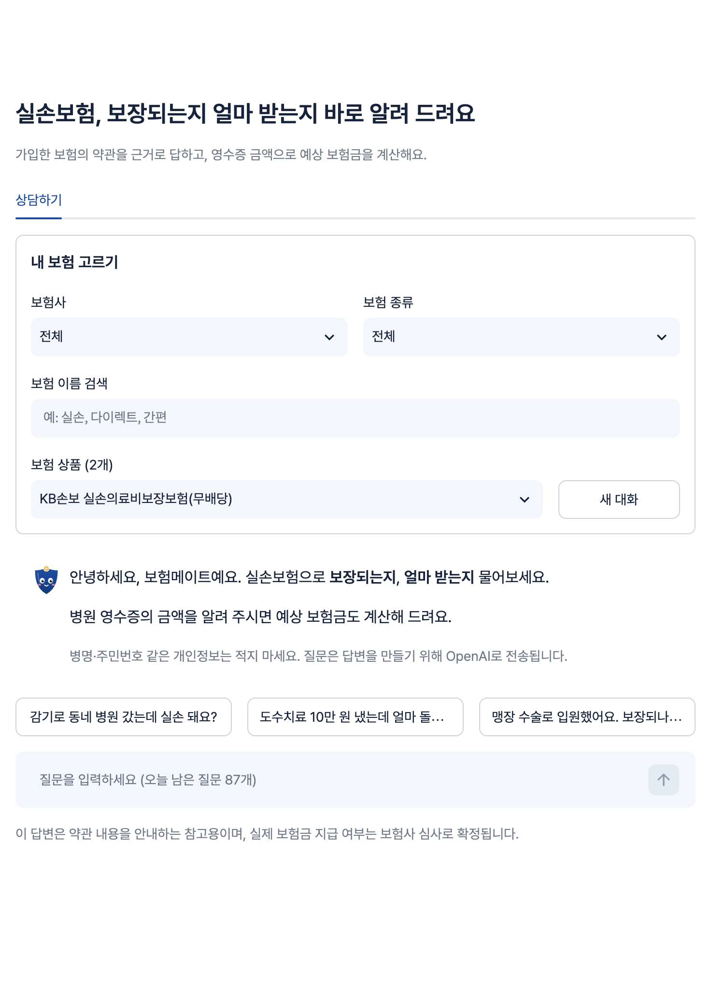
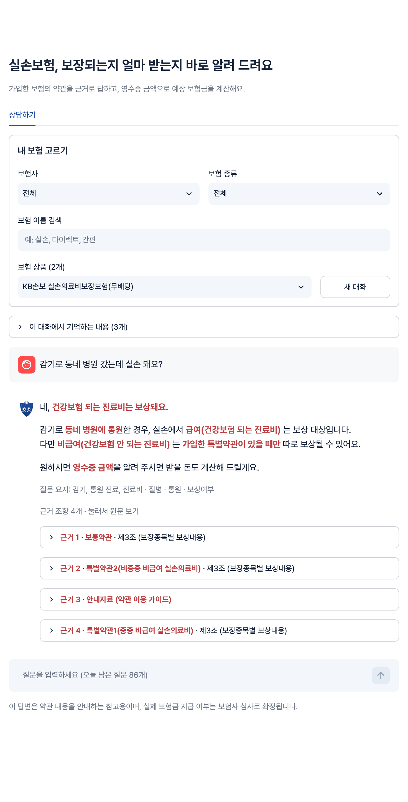
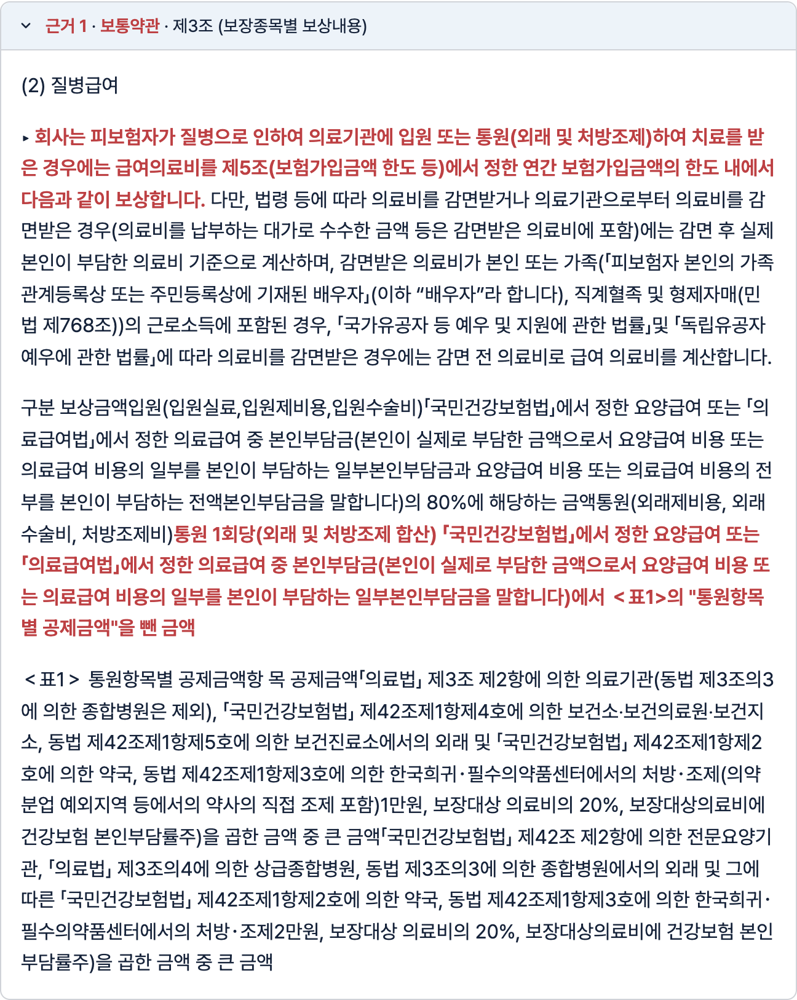
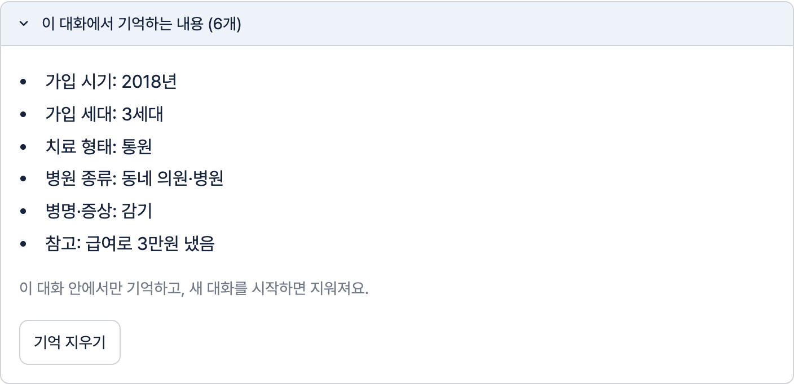
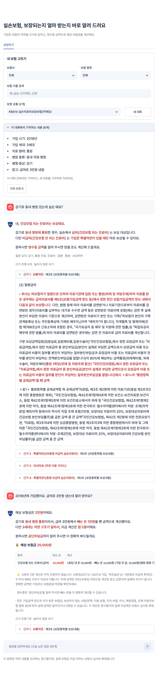
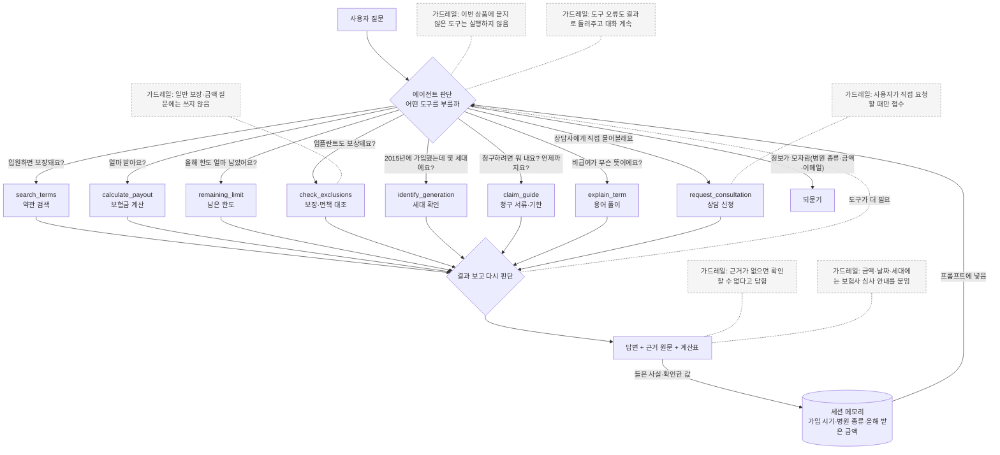
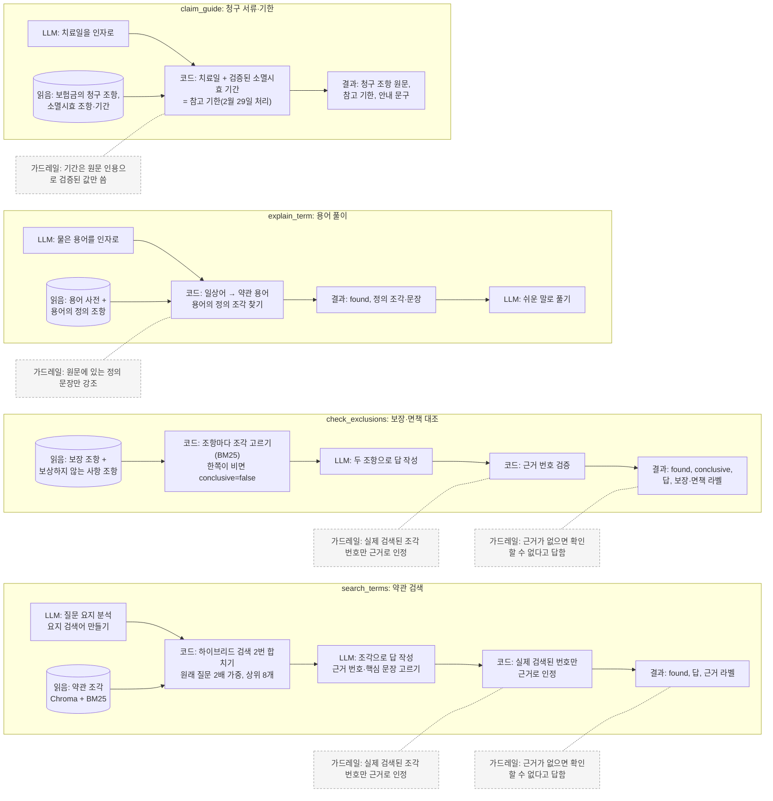
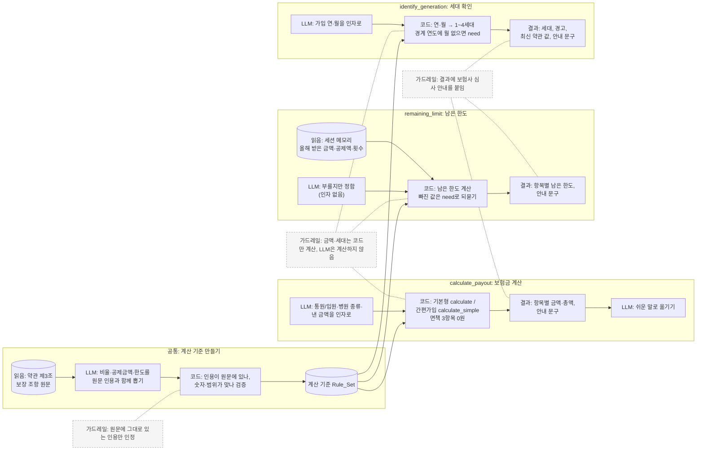
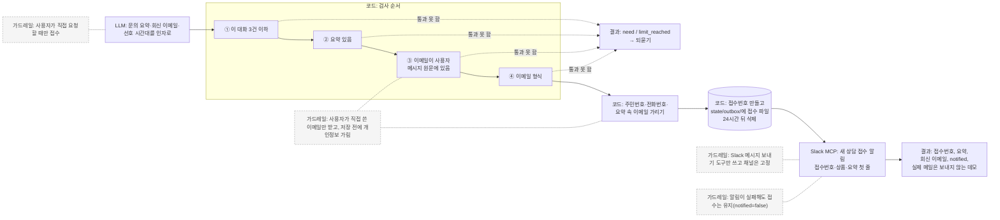

# 보험메이트 (boheom-mate) — 실손보험 약관 상담 에이전트

실손의료보험 약관을 읽고 상담하는 **AI 에이전트**입니다.

**서비스 주소: <https://boheommate.duckdns.org>**

사용자가 "감기로 동네 병원 갔는데 실손 돼요?", "급여로 3만원 냈는데 얼마 받아요?"처럼 물으면,
에이전트가 턴마다 **할 일을 스스로 판단해 도구를 호출**합니다. 약관을 검색해 근거와 함께 답하거나,
약관에서 뽑은 기준으로 보험금·남은 한도를 계산하거나, 면책 조항·청구 서류·약관 용어를 찾아 주거나, 정보가 모자라면 되묻습니다.
대화에서 들은 가입 시기·병원 종류·올해 받은 보험금 같은 정보는 **세션 메모리**에 남겨 다음 턴에 다시 묻지 않습니다.
고객이 "상담사에게 직접 문의하고 싶어요"라고 하면 채팅 안에서 **상담 신청**을 접수하고, 운영 채널에 **Slack MCP**로 새 접수 알림을 보냅니다.
약관 검색·계산 도구는 **MCP 서버**로도 내보내 다른 에이전트가 쓸 수 있습니다.
약관에서 근거를 찾지 못하면 지어내지 않고 "약관에서 확인할 수 없다"고 답합니다.

보험설계사는 답변의 근거 조항 원문과 핵심 문장을 바로 확인하고, 고객은 약관 용어 대신 쉬운 말로 결론을 먼저 듣습니다.

## 화면

| 상담 시작 | 약관 근거 답변 |
|---|---|
|  |  |

| 근거 원문 (핵심 문장만 강조) | 세션 메모리 |
|---|---|
|  |  |

| 이어지는 상담과 보험금 계산 |
|---|
|  |

- **질문 요지**(예: `감기 · 질병 · 통원 · 보상여부`)로 에이전트가 질문을 어떻게 이해했는지 보여 줍니다.
- 근거 조항은 `보통약관 · 제3조 (보장종목별 보상내용)`처럼 위치까지 표시하고, 누르면 원문이 펼쳐집니다.
  원문 전체가 아니라 **답변의 결론을 직접 뒷받침한 문장만** 붉게 강조합니다.
- 두 번째 질문("2018년에 가입했어요. 급여로 3만원 냈는데 얼마 받아요?")에서 에이전트는 앞에서 들은
  "감기, 동네 의원, 통원"을 메모리에서 꺼내 계산하고, 가입 연도로 세대(3세대)를 정해 참고 안내를 붙입니다.

## 에이전트 구성

에이전트는 질문을 보고 아래 도구 중 하나를 부르거나, 정보가 모자라면 되묻습니다. 화살표 글은 그 도구를 부르게 되는 질문의 예입니다.
회색 점선 상자는 그 자리에서 잘못된 동작을 막는 가드레일입니다(아래 "신뢰성 장치" 표).



### 도구 안쪽

도구마다 읽는 것(읽음), LLM이 하는 일(LLM), 코드가 정하는 일(코드), 돌려주는 것(결과)을 나눠 그렸습니다. 금액·날짜·세대·접수번호는 모두 코드가 정합니다.

**약관 근거 도구: `search_terms`, `check_exclusions`, `explain_term`, `claim_guide`**



**계산 도구: `calculate_payout`, `remaining_limit`, `identify_generation`**

세 도구는 같은 계산 기준(Rule_Set)을 씁니다. 계산 기준은 약관을 넣을 때 한 번 만들어 `state/rules/`에 저장합니다.



**상담 신청: `request_consultation`**



| 구성 요소 | 하는 일 | 구현 |
|---|---|---|
| 에이전트 | 턴마다 어떤 도구를 부를지, 되물을지 판단하고, 도구 결과를 보고 다시 판단해 답을 만든다. 시스템 프롬프트는 이번 턴에 붙은 도구의 규칙만으로 조립한다 | `ui/chat.py`, LangChain `ChatOpenAI.bind_tools`, `gpt-5.4-mini`, temperature 0 |
| 도구 레지스트리·디스패처 | 도구마다 스키마·프롬프트 규칙·사용 가능 조건·실행 함수·안내 문구 여부를 한곳에 둔다. 상품이 조건을 만족하는 도구만 붙이고, 없는 도구 호출은 거절하며, 도구 오류가 나도 대화를 이어 간다 | `ui/tools.py`(`REGISTRY`, `bound_tools`, `dispatch`) |
| 약관 RAG (`search_terms`) | 질문 요지 분석 → 원래 질문과 요지 검색어로 각각 하이브리드 검색 → 근거 조항만 써서 답변 | `core/rag.py`, LangChain `EnsembleRetriever`(벡터 검색: `OpenAIEmbeddings` + Chroma, 키워드 검색: `BM25Retriever` + kiwi 형태소 분석) |
| 약관 기반 계산 (`calculate_payout`, `remaining_limit`, `identify_generation`) | 상품 약관에서 뽑아 검증한 비율·공제금액·한도로 금액과 올해 남은 한도를 계산하고, 가입 연·월로 세대를 정한다 | `core/policy_rules.py`(추출·검증, Rule_Set v2), `core/calculator.py`(계산), `core/memory.py`(세대) |
| 약관 조항 도구 (`check_exclusions`, `claim_guide`, `explain_term`) | 보장·면책 조항, 청구·소멸시효 조항, 용어 정의 조항을 조 제목으로 찾아 원문과 함께 돌려준다 | `core/articles.py`, `core/claim.py`, `core/glossary.py` |
| 상담 신청 (`request_consultation`) | 문의 요약과 회신 이메일을 받아 접수번호를 만들고 접수 파일을 쓴 뒤, Slack MCP로 운영 채널에 알린다 | `core/consultation.py`, `store/outbox.py`, `integrations/mcp_client.py`(`langchain-mcp-adapters`) |
| MCP 서버 | 약관 검색·보험금 계산을 다른 에이전트가 MCP로 쓰게 내보낸다 | `mcp_server.py`(`mcp` FastMCP, 읽기 전용, 로컬 stdio) |
| 세션 메모리 | 한 대화 안에서 사용자가 말한 사실과 도구가 확인한 값을 정해진 칸에 저장하고 다음 턴 프롬프트에 넣는다 | `core/memory.py`, SQLite `session_memory` 표 |
| 근거 표시 | 근거 조항 원문을 정리하고 결론을 뒷받침한 문장만 강조 | `ui/display.py` |

모델을 학습시키지 않습니다. 모델은 그대로 쓰고 **약관을 검색해서 프롬프트에 넣어 주는 방식(RAG)** 입니다.

## 에이전트 도구

에이전트는 아래 도구 8개 중 **이번 상품에서 쓸 수 있는 것만** 받습니다. 조건을 만족하지 않는 도구는 프롬프트에도 들어가지 않습니다.
조건은 그 상품 약관에서 필요한 조항이나 계산 기준을 찾았는지입니다.

| 도구 | 하는 일 | 붙는 조건 |
|---|---|---|
| `search_terms` | 약관을 검색해 근거 조항·핵심 문장과 함께 답한다 | 항상 |
| `calculate_payout` | 영수증 금액과 진료 조건으로 예상 보험금을 계산한다. 기본형은 `calculate`, 간편가입은 `calculate_simple`(급여·비급여 합계에서 "정액과 30% 중 큰 금액" 공제, 연간 공제 상한, 면책 3항목 0원) | 계산 기준이 모두 검증된 상품 |
| `remaining_limit` | 올해 받은 보험금·공제액으로 남은 한도를 계산하고, 한도는 계약해당일 기준 1년이라고 안내한다 | 계산 기준이 모두 검증된 상품 |
| `check_exclusions` | 임신·출산, 치과, 미용·성형처럼 면책일 수 있는 항목을 콕 집어 물을 때 보장 조항과 면책 조항을 함께 돌려준다 | 보장 조항과 면책 조항을 모두 찾은 상품 |
| `identify_generation` | 가입 연·월로 실손 세대(1~4세대)를 정한다 | 항상 |
| `claim_guide` | 청구 서류와 참고 청구 기한(약관 소멸시효 조항의 기간을 치료일에 더한 날)을 약관 조항과 함께 안내한다 | 청구 조항을 찾은 상품 |
| `explain_term` | "비급여가 뭐예요?"처럼 용어 뜻을 물으면 약관의 용어 정의 조항을 찾아 쉬운 말로 풀어 준다 | 용어 정의 조항을 찾은 상품 |
| `request_consultation` | 상담 신청을 접수한다(아래 "상담 신청") | 항상 |

- 각 도구 결과에는 계산·판정 근거가 된 약관 조항이 함께 오고, 금액·면책·청구 기한·세대를 다루는 도구는 "참고용이며 보험사 심사로 확정된다"는 안내를 붙입니다.
- 도구를 늘려도 기존 답변이 바뀌지 않도록, 일반 보장 질문은 `search_terms`, 특정 항목의 면책 질문만 `check_exclusions`처럼 도구별 호출 규칙을 좁게 적었습니다.

### 상담 신청

- 사용자가 이번 턴에 사람 상담사와의 상담을 직접 요청했을 때만 부릅니다. 약관에서 답을 찾지 못한 턴에는 "원하시면 상담사 상담을 신청할 수 있어요" 한 줄만 붙입니다.
- 문의 요약과 회신 이메일이 있어야 접수합니다. 이메일은 사용자가 대화에 직접 쓴 주소만 받고, 형식이 틀리면 다시 묻습니다.
- 접수하면 `C-YYYYMMDD-XXXXXX` 형식의 접수번호를 만들고 답변 아래에 접수 내용(문의 요약, 회신 이메일, 선호 시간대)을 보여 줍니다.
- **이메일 상담 접수는 데모입니다.** 실제 메일은 보내지 않고 접수 파일을 `state/outbox/`에 쓰며, 24시간이 지나면 지웁니다. 한 대화에서 3건까지 접수할 수 있습니다.
- Slack 설정이 있으면 운영 채널에 "새 상담 접수" 알림을 1건 보냅니다. 알림에는 회신 이메일을 넣지 않습니다.

## 한 턴의 처리 순서

1. **메모리 불러오기**: 이 대화에서 기억한 내용(예: 가입 2018년 → 3세대, 동네 의원, 통원, 감기)을 에이전트 프롬프트에 넣습니다.
2. **할 일 판단**: 에이전트가 질문과 최근 대화를 보고 도구를 고릅니다. 이어지는 질문("대학병원이면요?")은
   앞 대화를 반영해 혼자 읽어도 뜻이 통하는 질문으로 바꿔 검색합니다.
3. **도구 1, 약관 검색(`search_terms`)**: 이 도구는 아래 용어로 설명합니다.
   - **질문 요지**: 질문을 정해진 보기(대상·원인·치료 형태·질문 유형·약관 용어)로 정리한 것. 화면에 "질문 요지"로 보입니다.
   - **요지 검색어**: 질문 요지를 약관 용어로 바꿔 만든 검색 문장. 표현이 달라도 뜻이 같은 질문은 같은 요지 검색어가 됩니다.
   - **하이브리드 검색**: 벡터 검색(뜻이 비슷한 조각)과 키워드 검색(BM25, 같은 단어가 든 조각)을 함께 쓰는 검색.

   원래 질문으로 한 번, 요지 검색어로 한 번 하이브리드 검색을 하고, 두 결과를 합쳐(원래 질문 결과에 2배 가중) 조각 8개를 고릅니다.
   원래 질문은 "1년에 최대" 같은 세부 표현을 살리고, 요지 검색어는 "보험가입금액 한도" 같은 약관의 조항 이름을 보탭니다.
   그 조각만 근거로 답하고, 근거마다 결론을 뒷받침한 문장을 함께 돌려줍니다.
4. **도구 2, 보험금 계산(`calculate_payout`)**: 영수증 금액과 진료 조건을 받아, 이 상품 약관에서 검증된 기준으로 코드가 계산합니다.
   가입 시기를 말했으면 세대도 코드가 정합니다(2009년 10월, 2017년 4월, 2021년 7월 기준).
   간편가입 상품은 메모리에 있는 올해 공제액·통원 횟수를 기본값으로 씁니다.
   면책 확인, 남은 한도, 청구 안내, 용어 설명, 상담 신청이 필요하면 해당 도구를 같은 방식으로 부릅니다.
5. **답변**: 결론을 먼저, 쉬운 말로 답하고 근거 원문·계산표·안내 문구를 함께 보여 줍니다.
6. **메모리 갱신**: 이번 턴에서 사용자가 말한 사실을 메모리에 반영합니다. 계산에 실제로 쓴 값과 도구가 확인한 값(가입 시기·세대, 올해 기수령액·공제액·통원 횟수, 계약해당일)은 정해진 칸으로만 옮깁니다.

## 신뢰성 장치

위 그림의 회색 점선 상자(가드레일)와 그 구현 위치입니다.

| 가드레일 | 구현 파일 |
|---|---|
| 근거가 없으면 "약관에서 확인할 수 없음"으로 답한다 | `core/rag.py`(`NOT_FOUND_MESSAGE`), `ui/tools.py`(`found=false` 규칙) |
| LLM이 댄 근거 번호 중 실제로 검색된 조각만 근거로 인정한다 | `core/rag.py`(`answer`) |
| 금액은 코드만 계산하고 LLM은 계산하지 않는다 | `ui/tools.py`(`CALCULATE_RULES`), `core/calculator.py` |
| 인용문이 약관 원문에 그대로 있어야 계산 기준으로 인정한다. 숫자가 인용 안에 있고, 그 항목을 가리키는 말(입원, MRI 등)이 인용 앞뒤에 있고, 값 범위가 맞아야 한다 | `core/policy_rules.py`(`verify`) |
| 일반 보장 질문과 금액 질문에는 면책 확인 도구를 쓰지 않는다 | `ui/tools.py`(`EXCLUSIONS_RULES`) |
| 상담 신청은 사용자가 직접 요청할 때만 접수한다 | `ui/tools.py`(`CONSULT_RULES`) |
| 상담 신청은 사용자가 대화에 직접 쓴 회신 이메일만 받고, 저장 전에 주민번호·전화번호(요약 속 이메일 포함)를 가린다 | `core/consultation.py`(`email_in_messages`), `core/outbound.py`(`scrub`) |
| 외부 MCP는 Slack "메시지 보내기" 도구만 허용하고 보낼 채널은 환경변수로 고정한다 | `integrations/mcp_client.py`(`ACTIONS`, `_slack_values`) |
| 도구 실행 오류가 나도 오류를 도구 결과로 돌려주고 대화를 계속한다 | `ui/tools.py`(`dispatch`, `CAUGHT_ERRORS`) |
| 이번 턴에 붙지 않은 도구 호출은 실행하지 않고 거절한다 | `ui/tools.py`(`dispatch`) |
| 금액·날짜·세대를 다루는 도구 결과에 "실제 지급 여부와 금액은 보험사 심사로 확정됩니다."를 붙인다 | `ui/tools.py`(`dispatch`, `Tool.disclaimer`) |

기본 상품(KB 실손의료비보장보험 26.09)에서 자동으로 뽑은 계산 기준 22개는 사람이 확인한 값과 모두 일치합니다.
간편가입 상품은 공제금액·연간 공제 상한 등 11개 값과 면책 3항목(도수치료·주사·MRI)을 같은 방식(Rule_Set v2)으로 원문 인용에 맞춰 검증합니다.

## 정확도

자체 평가셋 `eval/questions.json`으로 바꿀 때마다 점수를 비교했습니다. 평가셋은 개발용 20문항(답이 있는 17문항 + 답이 없는 3문항)과 최종 확인용 10문항으로 나뉩니다.
아래 정확도 수치는 모두 **자체 평가셋(개발용)** 결과입니다. 최종 확인용 10문항은 따로 두었고 이 표에는 넣지 않았습니다.
각 문항에는 정답 조각에 반드시 들어 있어야 할 약관 문구가 붙어 있고, 검색된 상위 8개 조각에 그 문구가 있으면 적중입니다.
이어지는 상담은 `eval/conversations.json`으로 평가합니다. 기존 시나리오 8개(11턴)에 더해, 도구마다 "이 질문이면 이 도구를 불러야 한다/부르면 안 된다"를 채점하는 tools 그룹이 있습니다.
실험별 가설, 변경 내용, 결과 파일, 판정은 [`eval/EXPERIMENTS.md`](eval/EXPERIMENTS.md)에 있습니다.

### 최종 결과 (자체 평가셋(개발용) 20문항 × 3회)

| 지표 | 값 |
|---|---|
| 검색 적중 (상위 8개 안에 정답 조각, 답이 있는 17문항 기준) | **94%** |
| 상위 3 적중 | **82%** |
| 거절 정확 (답이 없는 질문은 확인 불가로 답함) | **100%** |
| 답변 키워드 (답변에 정답 핵심어 포함) | **98%** |

이어지는 상담(`eval/conversations.json`)은 기존 시나리오 8개(11턴)를 **11/11** 통과했고, 기존 턴의 도구 선택 오류(부를 도구를 안 부르거나 다른 도구를 부름)는 **0**입니다.
기본 상품에서 약관으로 뽑은 계산 기준 22개는 **22/22** 사람이 확인한 값과 일치합니다.

### 개선 과정

검색 적중과 상위 3 적중은 자체 평가셋(개발용)에서 답이 있는 17문항 기준입니다.

| 실험 | 바꾼 것 | 검색 적중 | 상위 3 |
|---|---|---|---|
| E0 | 벡터 검색만 + 용어 사전 | 71% | 47% |
| E2 | + 키워드 검색(BM25)을 더한 하이브리드 검색 | 94% | 82% |
| E3 | + 질문 요지 분석과 요지 검색어 (표현만 다른 질문의 근거 일치 24% → 73%) | 76% | 59% |
| E4 | + 질문 유형별 필수 조항 | 82% | 76% |
| E5 | 에이전트(검색·계산·되묻기 도구 선택) + 쉬운 말 (어려운 용어 4.09개 → 1.09개) | – | – |
| E6 | 면책 조항을 항목 단위로 분할, 근거 1~3개로 제한 | 82% | 71% |
| E7 | LangChain 대조: 기본 설정(글자 수 청킹 + 벡터 검색만) 47% → 약관 구조 청킹 + 하이브리드 검색 88% | 88% | 82% |
| E9 | LangChain 전환 + 원래 질문과 요지 검색어로 각각 하이브리드 검색, 원래 질문 결과 2배 가중 | 94% | 82% |
| E10 | 약관에서 계산 기준 자동 추출·검증, 핵심 문장 강조, 세션 메모리 | 94% | 82% |
| E11 | 보상된다고 답할 때 근거의 비율·한도를 원문 숫자 그대로 함께 안내 (답변 키워드 94% → 98%) | 94% | 82% |

### 도구 확장 회귀 확인 (E12~E19)

도구를 단계별로 붙일 때마다 같은 합격선을 확인했습니다. 합격선은 **거절 정확 100%, 검색 적중 94% 이상, 기존 11턴 11/11, 기존 턴의 도구 선택 오류 0**입니다.

| 실험 | 붙인 것 | 결과 |
|---|---|---|
| E12 | 도구 확장 전 기준선 | 합격선 기준값 (검색 94%, 거절 100%, 11/11, 도구 선택 오류 0) |
| E13 | 간편가입 계산 | 합격, 간편가입 계산 문항 4턴 모두 기대 금액과 일치 |
| E14 | 도구 레지스트리·디스패처 | 합격, 프롬프트 길이와 도구 선택이 E13과 같음 |
| E15 | 상담 신청 | 합격선은 지켰으나 채점 문구 문제로 1턴 실패해 보류 → E16에서 해결 |
| E16 → E16b | 면책 확인·세대 판정·청구 안내·용어 설명 | E16은 일반 보장 질문에 면책 도구를 불러 도구 선택 오류 2건으로 보류, 호출 규칙을 좁힌 E16b에서 오류 0으로 합격 |
| E17 | 메모리 칸 확장과 `remaining_limit` | 합격, 채팅 26/26 |
| E18 | 병원 종류 판별 도구 (제거됨) | 합격, E19에서 뺌 |
| E19 | 병원 종류 판별·질병코드 찾기 도구 제거, README 다시 쓰기 | 같은 합격선으로 확인 (결과는 [`eval/EXPERIMENTS.md`](eval/EXPERIMENTS.md) E19) |

각 단계의 실패 원인과 수치는 [`eval/EXPERIMENTS.md`](eval/EXPERIMENTS.md)에 있습니다.

정확도를 가장 크게 올린 것은 **하이브리드 검색(키워드 검색 BM25 추가)과 약관 구조에 맞춘 청킹**입니다.
자체 평가셋(개발용)의 답이 있는 17문항에서 LangChain 기본 설정(글자 수 청킹 + 벡터 검색만)은 검색 적중 47%였고,
약관 구조에 맞춘 청킹과 한국어 형태소 분석을 쓴 키워드 검색을 LangChain 검색기에 얹어 94%가 됐습니다.

## 운영 기능

- **약관 넣기**: PDF → 구역(안내자료 / 보통약관 / 특별약관 / 제도성 특약 / 별표 / 관련 법규) 판별 → "제○조" 단위 분할 →
  긴 조항은 항목 번호(1. 2. / 가. 나. / ①) 경계에서 다시 분할 → 임베딩 → Chroma 저장.
  약관을 넣으면 계산 기준도 그 약관에서 다시 뽑습니다.
- **주간 약관 확인**: 매주 월요일 9시에 보험사 공시실에서 판매 중인 실손 약관을 확인해 새 판을 받고,
  조항 분할을 자동 점검해 Slack에 올립니다. 운영자가 Slack에서 "승인" 답글을 달면 5분 안에 사이트에 반영됩니다.
  KB손해보험은 자동으로 받고, 삼성화재·현대해상·DB손해보험은 운영자가 PDF를 `data/inbox/`에 넣으면 같은 절차로 반영됩니다.
- **내 보험 고르기**: 보험사 → 보험 종류 → 상품 이름 검색. 같은 상품의 판(예: 26.09)도 고를 수 있습니다.
- **사용량 관리**: 대화와 메모리는 브라우저 세션별로 SQLite에 저장되고, 모든 방문자를 합친 하루 질문 수에 한도가 있습니다.

## MCP 연동

보험메이트는 MCP(Model Context Protocol)를 두 방향으로 씁니다.

**MCP 서버: 다른 에이전트가 보험메이트 도구를 쓰게 내보내기** (`boheom_mate/mcp_server.py`)

다른 에이전트가 보험메이트의 약관 검색·계산을 표준 프로토콜로 부를 수 있게 여는 서버입니다. 현재는 로컬 stdio로만 열고 원격으로 공개하지 않습니다.
앱 동작에는 필요하지 않습니다.

| 도구 | 하는 일 |
|---|---|
| `list_products` | 상담할 수 있는 약관 목록 |
| `search_terms` | 약관 검색 → 근거 조항·핵심 문장과 함께 답변 (근거 없으면 found=false) |
| `calculate_payout` | 약관에서 검증한 기준으로 예상 보험금 계산 |

읽기 전용이라 저장·전송·삭제를 하지 않고, 상담 신청 도구는 내보내지 않습니다.
Kiro, Claude Desktop 같은 MCP 클라이언트에 `.venv/bin/python -m boheom_mate.mcp_server`(stdio)를 등록하면 됩니다.

**MCP 클라이언트: 새 상담 접수를 Slack으로 알리기** (`integrations/mcp_client.py`)

| 기능 | MCP 서버 | 쓰는 도구 | 상태 |
|---|---|---|---|
| 새 상담 접수 알림(`consult_notice`) | [Slack 공식 MCP 서버](https://docs.slack.dev/ai/slack-mcp-server/) (`mcp.slack.com/mcp`) | 메시지 보내기 | `.env`에 `SLACK_MCP_USER_TOKEN`(MCP를 켠 Slack 앱의 사용자 토큰, chat:write), `SLACK_HANDOFF_CHANNEL_ID`를 넣으면 켜짐 |

- Slack MCP는 상담 접수 알림에만 씁니다. 설정이 없으면 알림 없이 접수만 합니다.
- 키를 넣은 뒤 `.venv/bin/python -m boheom_mate.integrations.mcp_client --check`로 연결과 보내기 도구를 확인할 수 있습니다(아무것도 보내지 않음).
- 도구 이름·입력 칸 이름이 조금 달라도 정해 둔 후보(메시지 보내기 도구만)에서 찾아 맞춥니다.
- 허용 목록 밖 도구는 부르지 않고, 보낼 채널은 고정하며, 토큰은 오류 메시지에 넣지 않습니다.

## 실행 방법

Python 3.11 이상이 필요합니다.

```bash
python3.12 -m venv .venv
.venv/bin/pip install -r requirements.txt
echo 'OPENAI_API_KEY=sk-...' > .env   # OpenAI 키 입력
```

약관 PDF는 저장소에 포함하지 않습니다. [KB손해보험 공시실](https://www.kbinsure.co.kr/CG802030001.ec)에서
"KB손보 실손의료비보장보험(무배당)(26.09)" 약관을 내려받아 `data/` 폴더에 넣고,
앱의 "약관 넣기" 탭(로컬에서 `.env`에 `SHOW_INGEST_TAB=1`)에서 저장합니다.

선택 기능은 `.env`에 값을 넣으면 켜집니다. 넣지 않으면 그 기능만 꺼지고 나머지는 그대로 동작합니다.

| 환경변수 | 켜지는 기능 |
|---|---|
| `SLACK_MCP_USER_TOKEN`, `SLACK_HANDOFF_CHANNEL_ID` | 새 상담 접수 Slack 알림 |
| `CONSULT_INBOX_ADDRESS`, `OUTBOX_RETENTION_HOURS` | 상담 접수 파일의 받는 주소, 보관 시간(기본 24시간) |

```bash
.venv/bin/streamlit run boheom_mate/app.py                        # 앱 (http://localhost:8501)
.venv/bin/python eval/run_eval.py --retrieval-only --note "메모"   # 검색 정확도
.venv/bin/python eval/run_eval.py                                  # 답변까지 포함한 평가 (20문항 × 3회)
.venv/bin/python eval/run_paraphrase.py --note "메모"              # 표현만 다른 질문의 근거 일치
.venv/bin/python eval/run_chat.py --note "메모"                    # 이어지는 상담·계산·쉬운 말·도구 선택
.venv/bin/python -m boheom_mate.mcp_server                         # 보험메이트 MCP 서버 (stdio)
```

## 배포

- AWS EC2(t3.micro, 서울)에서 systemd로 앱(`boheom-mate.service`), 주간 약관 확인(`weekly-check.timer`, 월 09:00 KST),
  승인 반영(`apply-approved.timer`, 5분마다)을 실행합니다.
- nginx가 HTTPS(Let's Encrypt, 자동 갱신)와 검색 노출용 메타 정보(title, description, robots, sitemap)를 처리합니다.
- 코드는 `deploy/push.sh`로 올리고, 약관·벡터 DB·상태 파일(`data/`, `chroma_db/`, `state/`)은 서버가 원본입니다.
- Slack 설정과 운영 절차는 [`docs/slack-setup.md`](docs/slack-setup.md)에 있습니다.

## 파일 구성

```
boheom_mate/
├── app.py                 Streamlit 화면 (상담하기 / 약관 넣기, 상담 접수 내용 표시)
├── mcp_server.py          MCP 서버: 약관 검색·계산 도구를 다른 에이전트에 내보내기 (읽기 전용, stdio)
├── ui/
│   ├── chat.py            에이전트: 도구 선택 루프 (bind_tools), 붙은 도구 규칙으로 프롬프트 조립
│   ├── tools.py           도구 레지스트리·디스패처: 도구 8개의 스키마·규칙·사용 가능 조건·실행
│   └── display.py         근거 원문 정리, 핵심 문장 강조
├── core/
│   ├── rag.py             search_terms: 질문 요지 분석, 요지 검색어, 하이브리드 검색, 근거 기반 답변
│   ├── policy_rules.py    약관에서 계산 기준·면책 코드 범위 추출·인용 검증 (기본형·간편가입, Rule_Set v2)
│   ├── calculator.py      보험금 계산 (기본형 calculate, 간편가입 calculate_simple), 남은 한도
│   ├── articles.py        조 제목으로 보장·면책·청구·용어 정의 조항 찾기
│   ├── claim.py           청구 서류와 참고 청구 기한
│   ├── kcd.py             면책 코드 범위 추출(Rule_Set용, 도구 없음)
│   ├── consultation.py    상담 신청: 이메일 검증, 접수번호, 메일 제목·본문, 알림 글
│   ├── outbound.py        주민번호·전화번호·이메일 가리기
│   ├── memory.py          세션 메모리: 대화에서 들은 사실 정리, 가입 시기 → 세대
│   ├── ingest.py          PDF 추출, 구역 판별, 조항·항목 분할, 임베딩 저장
│   ├── keyword_search.py  키워드 검색(BM25)용 kiwi 형태소 분석
│   └── glossary.py        일상 표현 → 약관 용어 사전
├── store/
│   ├── question_store.py  대화·메모리 저장, 하루 질문 한도 (SQLite)
│   ├── outbox.py          상담 접수 파일 쓰기, 24시간 지난 파일 삭제
│   ├── products.py        보험사·상품·판 목록
│   └── sync_state.py      주간 확인 상태
├── integrations/
│   ├── mcp_client.py      MCP 클라이언트: Slack 메시지 보내기 도구만, 채널 고정 (상담 접수 알림)
│   ├── slack_notify.py    Slack 알림과 승인 읽기
│   └── insurers/          보험사 공시실 모듈 (자동 / 수동 보험사 등록)
└── jobs/
    ├── weekly_check.py    주간 약관 확인
    ├── apply_approved.py  승인된 약관 반영
    └── split_check.py     조항 분할 점검
eval/                      평가셋, 평가 스크립트, 실험 기록과 결과
deploy/                    systemd, nginx, 배포 스크립트
```

> 이 서비스의 답변과 계산은 약관 내용을 안내하는 참고용이며, 실제 보험금 지급 여부와 금액은 보험사 심사로 확정됩니다.
