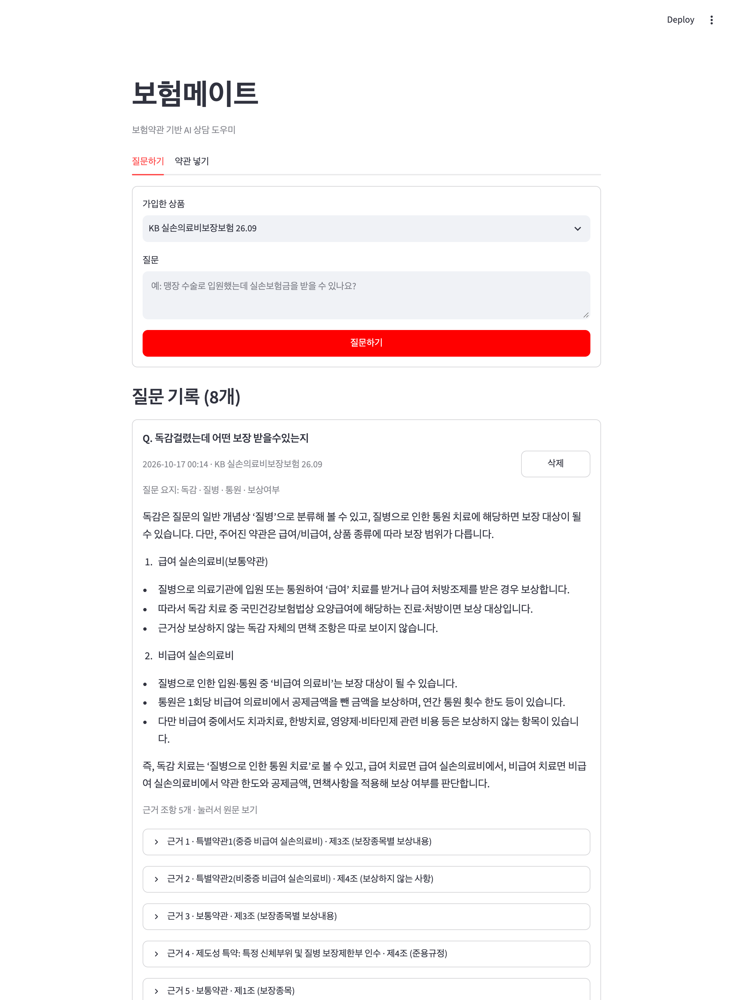
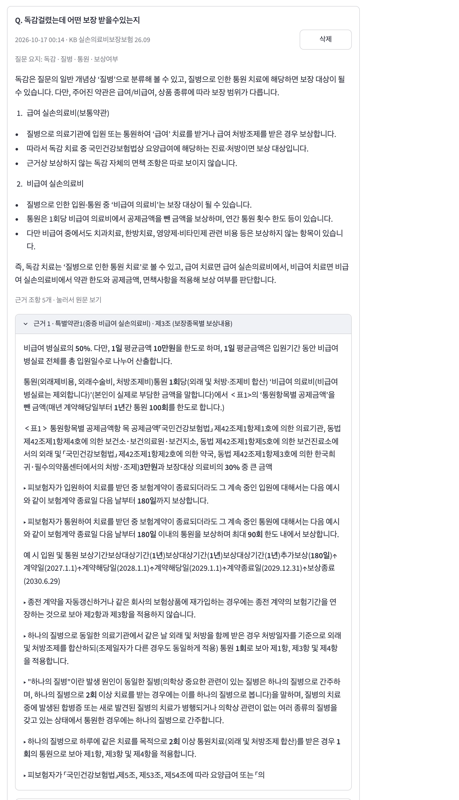
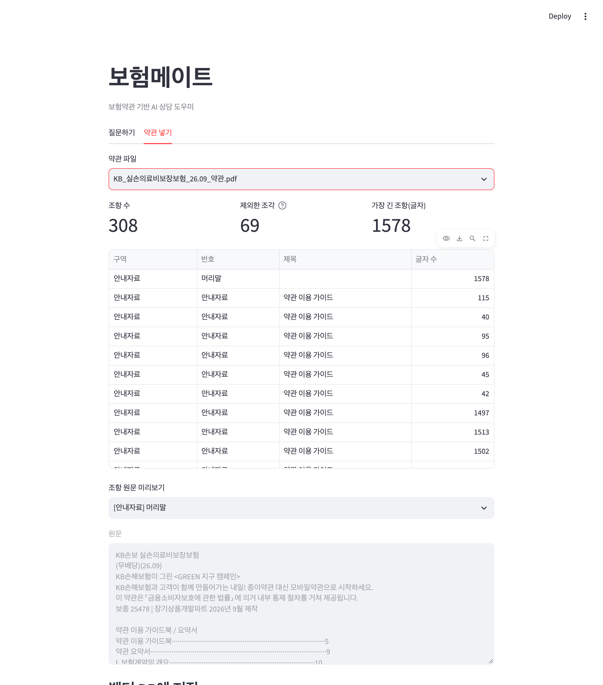
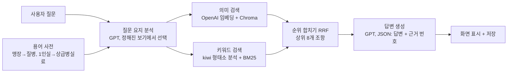

# 보험메이트 (boheom-mate)

보험약관을 근거로 답하는 실손의료보험 질의응답 앱입니다.
"맹장 수술 했는데 보장받을 수 있나요?" 같은 일상 질문을 약관 용어로 바꿔 관련 조항을 찾고,
**답변과 함께 근거가 된 약관 원문을 보여 줍니다.** 약관에서 근거를 찾지 못하면 지어내지 않고 "확인할 수 없다"고 답합니다.

**배포 주소: https://boheommate.duckdns.org** (AWS EC2, 서울 리전)

## 화면

| 질문하기 | 근거 조항 원문 |
|---|---|
|  |  |

- GPT가 질문을 어떻게 이해했는지 **질문 요지**(예: `독감 · 질병 · 통원 · 보상여부`)로 보여 줍니다.
- 근거 조항은 `특별약관1(중증 비급여 실손의료비) · 제3조 (보장종목별 보상내용)`처럼 약관의 어느 부분인지까지 표시합니다.
- 금액·비율·기간은 굵게 표시하고, PDF에서 끊긴 줄을 이어 붙여 읽기 쉽게 다듬었습니다.

| 약관 넣기 |
|---|
|  |

약관 PDF를 조항 단위로 자른 결과(구역, 조항 번호, 제목, 길이)를 확인한 뒤 벡터 DB에 저장합니다.

## 핵심 기능

1. **약관 넣기**: PDF → 구역(안내자료/보통약관/특별약관/별표/관련 법규) 판별 → "제○조" 단위 분할 → 임베딩 → Chroma 저장
2. **질문 → 검색 → 답변**: 질문 요지 분석 → 하이브리드 검색(의미 + 키워드) → 근거 기반 답변
3. **근거 조항 원문 표시**: 답변에 쓴 조항만 근거로 표시하고, 근거가 없으면 "확인 불가".
   금액·비율과 "보상하지 않습니다" 같은 판정 표현은 붉은색으로 강조합니다
4. **이어지는 상담 + 보험금 계산기**: 채팅으로 "감기 보장돼요?" → "15,000원 냈어요" → "대학병원이었으면요?"처럼 이어서 묻습니다.
   GPT가 턴마다 약관 검색 / 계산 / 되묻기 중 하나를 고르고(OpenAI 도구 호출), **금액은 GPT가 아니라 약관 제3조 공식을 옮긴 코드가 계산**합니다.
   답변은 "급여 → 건강보험 되는 진료비"처럼 쉬운 말로 바꿉니다
5. **내 보험 고르기**: 보험사 → 보험 종류 → 상품 이름 검색. 약관은 운영자가 미리 넣어 두는 방식이며, 지금은 KB 실손 2개만 상담할 수 있습니다

대화는 브라우저 세션별로 SQLite에 저장되고, 모든 방문자를 합친 하루 질문 수에 한도가 있습니다.

### 직접 써 보고 얻은 인사이트
RAG로 근거 조항을 정확히 찾아 줘도, 사용자가 원하는 건 조항이 아니라 **"그래서 얼마 받는데?"** 였습니다.
또 "급여·비급여" 같은 용어를 모르고, 질문 하나로 끝나지 않고 대화로 이어서 묻습니다.
그래서 계산기와 이어지는 대화, 쉬운 말 답변을 추가했습니다(실험 E5).

## 동작 구조



| 단계 | 담당 |
|---|---|
| 질문 요지 파악, 답변 작성 | OpenAI `gpt-5.4-mini` (temperature 0, 같은 질문은 분석 결과 재사용) |
| 문장 → 벡터 변환 | OpenAI `text-embedding-3-small` |
| 의미 검색, 키워드 검색, 순위 합치기 | 앱 내부 (Chroma, kiwipiepy, 직접 구현한 BM25) |

모델을 학습시키지 않습니다. 모델은 그대로 쓰고, **약관 데이터를 검색해서 프롬프트에 넣어 주는 방식(RAG)** 입니다.
LangChain 같은 프레임워크 없이 검색 → 프롬프트 → 답변 흐름을 직접 구현했습니다.

## 정확도 개선 과정

평가셋(`eval/questions.json`, 개발용 20문항 + 최종 확인용 10문항)을 만들고, 바꿀 때마다 점수를 비교했습니다.
실험별 가설, 변경 내용, 결과 파일, 판정 이유는 [`eval/EXPERIMENTS.md`](eval/EXPERIMENTS.md)에 있습니다.

| 실험 | 바꾼 것 | 검색 적중 | 상위 3 적중 | MRR | 표현 바꿔도 같은 근거 |
|---|---|---|---|---|---|
| E0 | 벡터 검색 + 용어 사전 | 71% | 47% | 0.36 | – |
| E1 | 약관 구역 꼬리표 + 조항 경계 오류 수정 | 53% | 35% | 0.36 | – |
| E2 | + 키워드 검색(BM25) + 키워드 추출 | **94%** | **82%** | 0.59 | 24% |
| E3 | + 질문 요지를 정해진 보기에서 선택 | 76% | 59% | 0.50 | **73%** |
| E3b | E3 + 원래 질문도 검색어로 사용 | 82% | 76% | 0.60 | 54% |
| E4 (현재) | + 질문 유형별 필수 조항(보상여부 → 보상내용 + 면책) | 82% | 76% | **0.63** | 58% |

- **검색 적중**: 상위 8개 안에 정답 조항이 있는가 / **MRR**: 정답 조항이 몇 등인가(1.00 만점)
- **표현 바꿔도 같은 근거**: "독감걸렸는데 어떤 보장 받을수있는지"와 "저 그럼 독감걸렸는데 받을수있나요?"처럼
  뜻이 같은 질문끼리 근거 조항이 얼마나 겹치는가(`eval/paraphrases.json`)
- 아직 정확도와 일관성을 동시에 최고로 만들지 못했습니다. 다음 실험은 필수 조항에서 조각을 여러 개 고르는 것입니다.

## 실행 방법

Python 3.11 이상이 필요합니다.

```bash
python3.12 -m venv .venv
.venv/bin/pip install -r requirements.txt
cp .env.example .env          # .env에 OpenAI API 키 입력
```

약관 PDF는 저장소에 포함하지 않았습니다. [KB손해보험 공시실](https://www.kbinsure.co.kr/CG802030001.ec)에서
"KB손보 실손의료비보장보험(무배당)(26.09)" 약관을 내려받아 `data/` 폴더에 넣으세요.

```bash
.venv/bin/streamlit run app.py                                   # 앱 실행 (http://localhost:8501)
.venv/bin/python eval/run_eval.py --retrieval-only --note "메모"   # 검색 정확도 평가
.venv/bin/python eval/run_eval.py                                # 답변까지 포함한 평가 (20문항 × 3회)
.venv/bin/python eval/run_paraphrase.py --note "메모"              # 표현만 다른 질문의 일관성 평가
.venv/bin/python eval/run_chat.py --note "메모"                    # 이어지는 대화·계산·쉬운 말 평가 (8개 시나리오)
.venv/bin/python tests/test_calculator.py                        # 계산기 테스트 (손으로 계산한 20개 사례)
```

앱의 "약관 넣기" 탭에서 PDF를 고르고 저장하면 질문할 수 있습니다. (로컬에서 `.env`에 `SHOW_INGEST_TAB=1`을 넣었을 때만 보입니다.)

배포 서버에서는 **주간 약관 확인**이 약관을 넣습니다. 매주 월요일 9시에 보험사 공시실에서 판매 중인 실손 약관을 확인해 새 약관을 받고,
조항 나누기를 자동 점검해 Slack에 올립니다. 운영자가 Slack에서 "승인" 답글을 달면 5분 안에 사이트에 반영됩니다.
설정 방법은 [`docs/slack-setup.md`](docs/slack-setup.md)에 있습니다.

## 파일 구성

| 파일 | 역할 |
|---|---|
| `app.py` | Streamlit 화면 (상담하기 채팅 / 약관 넣기) |
| `chat.py` | 이어지는 대화: GPT가 약관 검색·계산기·되묻기 중 하나를 고르는 도구 호출 |
| `calculator.py` | 실손 보험금 계산기 (기본 약관 제3조 공식) |
| `products.py` | 보험사·보험 종류·상품 목록 (내 보험 고르기) |
| `ingest.py` | PDF 텍스트 추출, 구역 판별, 조항 분할, 임베딩 저장 |
| `rag.py` | 질문 요지 분석, 하이브리드 검색, 답변 생성 |
| `keyword_search.py` | 한국어 형태소 분석(kiwi)과 BM25 키워드 검색 |
| `glossary.py` | 일상 표현 → 약관 용어 사전 |
| `display.py` | 근거 원문을 읽기 좋게 다듬기 |
| `question_store.py` | 대화 저장, 하루 질문 한도 (SQLite) |
| `assets/` | 로고 (텍스트 로고, 캐릭터 로고, 생성 스크립트) |
| `tests/` | 계산기 테스트 |
| `eval/` | 평가셋, 평가 스크립트, 실험 기록과 결과 |

## 한계와 다음 할 일

- 현재 개선 작업은 기본 실손 약관 1개로만 했습니다. 다른 상품 약관(간편가입 등)은 구역 판별 규칙이 맞지 않아 보완이 필요합니다.
- PDF의 표는 줄 구조가 사라진 채 추출되어 한 줄로 뭉쳐 보입니다.
- 계산기는 기본 약관만 지원하고, 연간 한도·이미 받은 금액·면책은 계산하지 않습니다(안내 문구로 알림).
- 보험사·상품 목록은 껍데기입니다. 약관을 하나씩 넣으면서 `products.py`의 `source`를 채웁니다.
- 대화 평가 시나리오가 8개로 적습니다.

> 이 앱의 답변은 약관 내용을 안내하는 참고용이며, 실제 보험금 지급 여부는 보험사 심사로 확정됩니다.
