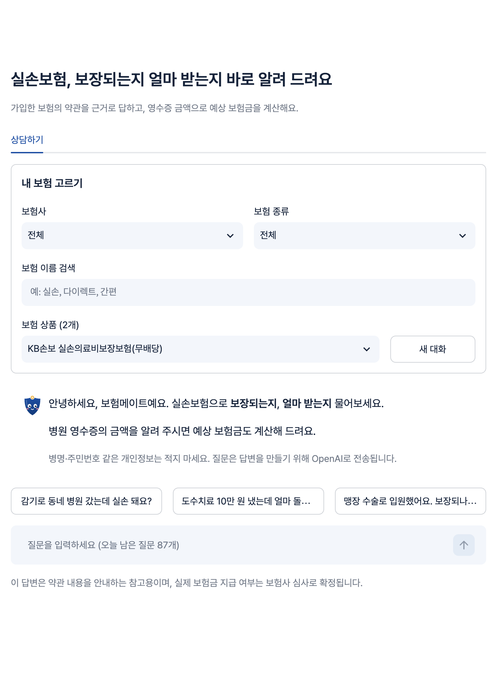
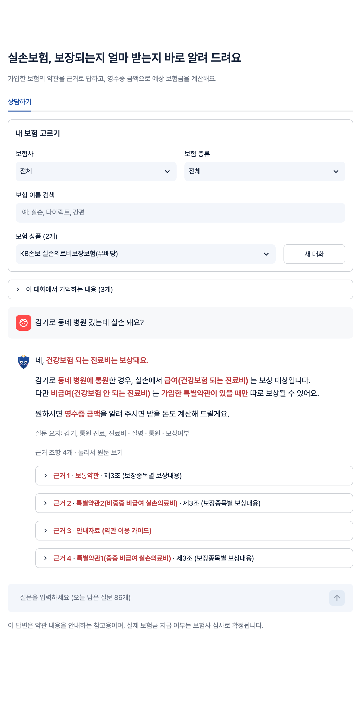
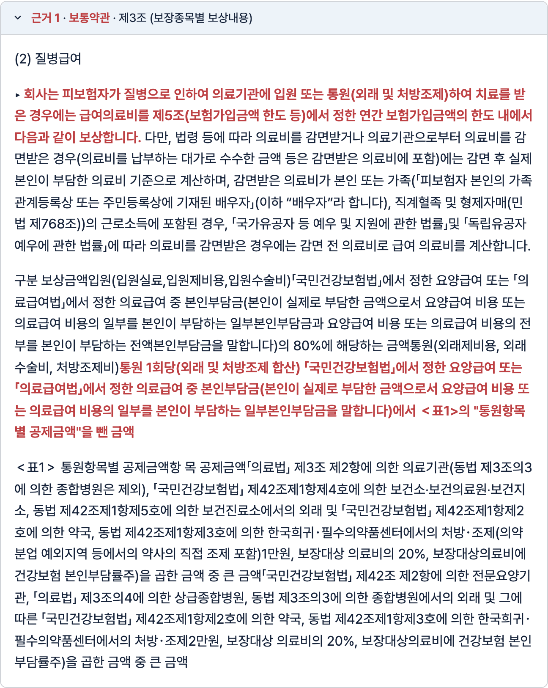
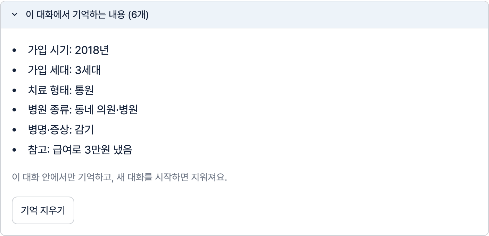
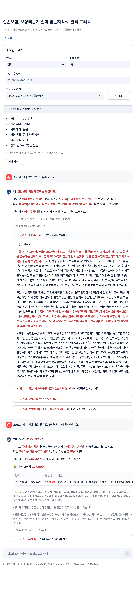
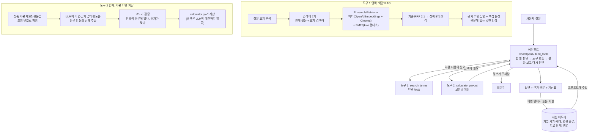

# 보험메이트 (boheom-mate) — 실손보험 약관 상담 에이전트

실손의료보험 약관을 읽고 상담하는 **AI 에이전트**입니다.
사용자가 "감기로 동네 병원 갔는데 실손 돼요?", "급여로 3만원 냈는데 얼마 받아요?"처럼 물으면,
에이전트가 턴마다 **할 일을 스스로 판단해 도구를 호출**합니다. 약관을 검색해 근거와 함께 답하거나,
약관에서 뽑은 기준으로 보험금을 계산하거나, 정보가 모자라면 되묻습니다.
대화에서 들은 가입 시기·병원 종류 같은 정보는 **세션 메모리**에 남겨 다음 턴에 다시 묻지 않습니다.
약관에서 근거를 찾지 못하면 지어내지 않고 "약관에서 확인할 수 없다"고 답합니다.

**서비스 주소: https://boheommate.duckdns.org** (AWS EC2, 서울 리전)

보험설계사는 답변의 근거 조항 원문과 핵심 문장을 바로 확인하고, 고객은 약관 용어 대신 쉬운 말로 결론을 먼저 듣습니다.

## 화면

| 상담 시작 | 약관 근거 답변 |
|---|---|
|  |  |

| 근거 원문 (핵심 문장만 강조) | 세션 메모리 |
|---|---|
|  |  |

| 이어지는 상담과 보험금 계산 |
|---|
|  |

- **질문 요지**(예: `감기 · 질병 · 통원 · 보상여부`)로 에이전트가 질문을 어떻게 이해했는지 보여 줍니다.
- 근거 조항은 `보통약관 · 제3조 (보장종목별 보상내용)`처럼 위치까지 표시하고, 누르면 원문이 펼쳐집니다.
  원문 전체가 아니라 **답변의 결론을 직접 뒷받침한 문장만** 붉게 강조합니다.
- 두 번째 질문("2018년에 가입했어요. 급여로 3만원 냈는데 얼마 받아요?")에서 에이전트는 앞에서 들은
  "감기, 동네 의원, 통원"을 메모리에서 꺼내 계산하고, 가입 연도로 세대(3세대)를 정해 참고 안내를 붙입니다.

## 에이전트 구성



| 구성 요소 | 하는 일 | 구현 |
|---|---|---|
| 에이전트 | 턴마다 약관 검색 / 보험금 계산 / 되묻기 중 할 일을 판단하고, 도구 결과를 보고 다시 판단해 답을 만든다 | `ui/chat.py`, LangChain `ChatOpenAI.bind_tools`, `gpt-5.4-mini`, temperature 0 |
| 도구 1: 약관 RAG | 질문 요지 분석 → 하이브리드 검색 → 근거 조항만 써서 답변 | `core/rag.py`, `EnsembleRetriever`(Chroma 벡터 + `BM25Retriever`) |
| 도구 2: 보험금 계산 | 상품 약관에서 뽑아 검증한 비율·공제금액·한도로 금액 계산 | `core/policy_rules.py`(추출·검증), `core/calculator.py`(계산) |
| 세션 메모리 | 한 대화 안에서 사용자가 말한 사실을 정해진 칸에 저장하고 다음 턴 프롬프트에 넣는다 | `core/memory.py`, SQLite `session_memory` 표 |
| 근거 표시 | 근거 조항 원문을 정리하고 결론을 뒷받침한 문장만 강조 | `ui/display.py` |

모델을 학습시키지 않습니다. 모델은 그대로 쓰고 **약관을 검색해서 프롬프트에 넣어 주는 방식(RAG)** 입니다.

## 한 턴의 처리 순서

1. **메모리 불러오기**: 이 대화에서 기억한 내용(예: 가입 2018년 → 3세대, 동네 의원, 통원, 감기)을 에이전트 프롬프트에 넣습니다.
2. **할 일 판단**: 에이전트가 질문과 최근 대화를 보고 도구를 고릅니다. 이어지는 질문("대학병원이면요?")은
   앞 대화를 반영해 혼자 읽어도 뜻이 통하는 질문으로 바꿔 검색합니다.
3. **도구 1, 약관 검색**: 질문 요지(대상·원인·치료 형태·질문 유형·약관 용어)를 정해진 보기에서 고르고,
   원래 질문과 요지 검색어로 하이브리드 검색해 조각 8개를 고릅니다. 그 조각만 근거로 답하고,
   근거마다 결론을 뒷받침한 문장을 함께 돌려줍니다.
4. **도구 2, 보험금 계산**: 영수증 금액과 진료 조건을 받아, 이 상품 약관에서 검증된 기준으로 코드가 계산합니다.
   가입 시기를 말했으면 세대도 코드가 정합니다(2009년 10월, 2017년 4월, 2021년 7월 기준).
5. **답변**: 결론을 먼저, 쉬운 말로 답하고 근거 원문·계산표·안내 문구를 함께 보여 줍니다.
6. **메모리 갱신**: 이번 턴에서 사용자가 말한 사실을 메모리에 반영합니다. 계산에 실제로 쓴 값은 그대로 옮깁니다.

## 신뢰성 장치

| 위험 | 막는 방법 |
|---|---|
| 근거 없는 답 | 실제 검색된 조각 번호만 근거로 인정하고, 유효한 근거가 없으면 정해진 안내 문구로 답합니다 |
| 근거 강조가 엉뚱함 | 핵심 문장은 근거 원문에 그대로 있을 때만 강조합니다. "보상합니다" 같은 단어 하나로는 칠하지 않습니다 |
| 의료비가 아닌 질문 | 차량 수리비·재산 손해 등은 비슷한 단어가 조항에 보여도 확인 불가로 답합니다 |
| 금액을 지어냄 | 금액은 코드가 계산합니다. 계산 기준값은 약관 원문 인용으로 검증된 것만 쓰고, 필수 값이 하나라도 검증되지 않은 상품은 계산하지 않습니다 |
| 다른 항목의 숫자를 인용 | 인용 구절 앞뒤에 그 항목을 가리키는 말(입원, 상급종합병원, MRI 등)이 있어야 하고, 종합병원 공제는 의원 공제보다 커야 합니다 |
| 메모리가 틀림 | 메모리는 정해진 칸과 보기만 받습니다. 세대는 가입 연·월로 코드가 계산하고, 경계 연도에 월을 모르면 비워 둡니다. 개인정보는 적지 않고, 사용자가 "기억 지우기"로 지울 수 있습니다 |

기본 상품(KB 실손의료비보장보험 26.09)에서 자동으로 뽑은 계산 기준 22개는 사람이 확인한 값과 모두 일치합니다.

## 정확도

평가셋 `eval/questions.json`(개발용 20문항 + 최종 확인용 10문항)으로 바꿀 때마다 점수를 비교했습니다.
각 문항에는 정답 조각에 반드시 들어 있어야 할 약관 문구가 붙어 있고, 검색된 상위 8개 조각에 그 문구가 있으면 적중입니다.
이어지는 상담은 `eval/conversations.json`(시나리오 8개, 11턴)으로 평가합니다.
실험별 가설, 변경 내용, 결과 파일, 판정은 [`eval/EXPERIMENTS.md`](eval/EXPERIMENTS.md)에 있습니다.

### 최종 결과 (개발용 20문항 × 3회)

| 지표 | 값 |
|---|---|
| 검색 적중 (상위 8개 안에 정답 조각) | **94%** |
| 상위 3 적중 | **82%** |
| 거절 정확 (답이 없는 질문은 확인 불가로 답함) | **100%** |
| 답변 키워드 (답변에 정답 핵심어 포함) | **94%** |
| 이어지는 상담 시나리오 (8개, 11턴) | **11/11 통과**, 답변당 어려운 용어 1.18개, 평균 4.1초 |
| 약관에서 뽑은 계산 기준 (22개) | **22/22** 사람이 확인한 값과 일치 |

### 개선 과정

| 실험 | 바꾼 것 | 검색 적중 | 상위 3 |
|---|---|---|---|
| E0 | 벡터 검색 + 용어 사전 | 71% | 47% |
| E2 | + 키워드 검색(BM25) | 94% | 82% |
| E3 | + 질문 요지를 정해진 보기에서 선택 (표현만 다른 질문의 근거 일치 24% → 73%) | 76% | 59% |
| E4 | + 질문 유형별 필수 조항 | 82% | 76% |
| E5 | 에이전트(검색·계산·되묻기 도구 선택) + 쉬운 말 (어려운 용어 4.09개 → 1.09개) | – | – |
| E6 | 면책 조항을 항목 단위로 분할, 근거 1~3개로 제한 | 82% | 71% |
| E7 | LangChain 대조: 기본 설정 47% → 우리 청킹 + BM25 하이브리드 88% | 88% | 82% |
| E9 | LangChain 전환 + 원래 질문·요지 검색어 2:1 | 94% | 82% |
| **E10** | **약관에서 계산 기준 자동 추출·검증, 핵심 문장 강조, 세션 메모리** | **94%** | **82%** |

정확도를 가장 크게 올린 것은 **키워드 검색(BM25)과 약관 구조에 맞춘 청킹**입니다.
LangChain 기본 설정(글자 수 청킹 + 벡터 검색)은 같은 평가셋에서 47%였고,
약관 구조에 맞춘 청킹과 한국어 형태소 BM25를 LangChain 검색기에 얹어 94%가 됐습니다.

## 운영 기능

- **약관 넣기**: PDF → 구역(안내자료 / 보통약관 / 특별약관 / 제도성 특약 / 별표 / 관련 법규) 판별 → "제○조" 단위 분할 →
  긴 조항은 항목 번호(1. 2. / 가. 나. / ①) 경계에서 다시 분할 → 임베딩 → Chroma 저장.
  약관을 넣으면 계산 기준도 그 약관에서 다시 뽑습니다.
- **주간 약관 확인**: 매주 월요일 9시에 보험사 공시실에서 판매 중인 실손 약관을 확인해 새 판을 받고,
  조항 분할을 자동 점검해 Slack에 올립니다. 운영자가 Slack에서 "승인" 답글을 달면 5분 안에 사이트에 반영됩니다.
  KB손해보험은 자동으로 받고, 삼성화재·현대해상·DB손해보험은 운영자가 PDF를 `data/inbox/`에 넣으면 같은 절차로 반영됩니다.
- **내 보험 고르기**: 보험사 → 보험 종류 → 상품 이름 검색. 같은 상품의 판(예: 26.09)도 고를 수 있습니다.
- **사용량 관리**: 대화와 메모리는 브라우저 세션별로 SQLite에 저장되고, 모든 방문자를 합친 하루 질문 수에 한도가 있습니다.

## 실행 방법

Python 3.11 이상이 필요합니다.

```bash
python3.12 -m venv .venv
.venv/bin/pip install -r requirements.txt
cp .env.example .env          # .env에 OPENAI_API_KEY 입력
```

약관 PDF는 저장소에 포함하지 않습니다. [KB손해보험 공시실](https://www.kbinsure.co.kr/CG802030001.ec)에서
"KB손보 실손의료비보장보험(무배당)(26.09)" 약관을 내려받아 `data/` 폴더에 넣고,
앱의 "약관 넣기" 탭(로컬에서 `.env`에 `SHOW_INGEST_TAB=1`)에서 저장합니다.

```bash
.venv/bin/streamlit run boheom_mate/app.py                        # 앱 (http://localhost:8501)
.venv/bin/python eval/run_eval.py --retrieval-only --note "메모"   # 검색 정확도
.venv/bin/python eval/run_eval.py                                  # 답변까지 포함한 평가 (20문항 × 3회)
.venv/bin/python eval/run_paraphrase.py --note "메모"              # 표현만 다른 질문의 근거 일치
.venv/bin/python eval/run_chat.py --note "메모"                    # 이어지는 상담·계산·쉬운 말
.venv/bin/python tests/test_calculator.py                          # 테스트 (tests/test_*.py 각각 실행)
```

## 배포

- AWS EC2(t3.micro, 서울)에서 systemd로 앱(`boheom-mate.service`), 주간 약관 확인(`weekly-check.timer`, 월 09:00 KST),
  승인 반영(`apply-approved.timer`, 5분마다)을 실행합니다.
- nginx가 HTTPS(Let's Encrypt, 자동 갱신)와 검색 노출용 메타 정보(title, description, robots, sitemap)를 처리합니다.
- 코드는 `deploy/push.sh`로 올리고, 약관·벡터 DB·상태 파일(`data/`, `chroma_db/`, `state/`)은 서버가 원본입니다.
- Slack 설정과 운영 절차는 [`docs/slack-setup.md`](docs/slack-setup.md)에 있습니다.

## 파일 구성

```
boheom_mate/
├── app.py                 Streamlit 화면 (상담하기 / 약관 넣기)
├── ui/
│   ├── chat.py            에이전트: 약관 검색·계산·되묻기 도구 선택 루프 (bind_tools)
│   └── display.py         근거 원문 정리, 핵심 문장 강조
├── core/
│   ├── rag.py             도구 1: 질문 요지 분석, LangChain 하이브리드 검색, 근거 기반 답변
│   ├── policy_rules.py    도구 2: 약관에서 계산 기준 추출·인용 검증
│   ├── calculator.py      도구 2: 보험금 계산 (약관 제3조 공식)
│   ├── memory.py          세션 메모리: 대화에서 들은 사실 정리, 가입 시기 → 세대
│   ├── ingest.py          PDF 추출, 구역 판별, 조항·항목 분할, 임베딩 저장
│   ├── keyword_search.py  kiwi 형태소 토큰화
│   └── glossary.py        일상 표현 → 약관 용어 사전
├── store/
│   ├── question_store.py  대화·메모리 저장, 하루 질문 한도 (SQLite)
│   ├── products.py        보험사·상품·판 목록
│   └── sync_state.py      주간 확인 상태
├── integrations/
│   ├── slack_notify.py    Slack 알림과 승인 읽기
│   └── insurers/          보험사 공시실 모듈 (자동 / 수동 보험사 등록)
└── jobs/
    ├── weekly_check.py    주간 약관 확인
    ├── apply_approved.py  승인된 약관 반영
    └── split_check.py     조항 분할 점검
eval/                      평가셋, 평가 스크립트, 실험 기록과 결과
tests/                     테스트 (계산기, 계산 기준 검증, 메모리, 근거 강조, 조항 분할, 주간 확인 등 12개)
deploy/                    systemd, nginx, 배포 스크립트
```

> 이 서비스의 답변과 계산은 약관 내용을 안내하는 참고용이며, 실제 보험금 지급 여부와 금액은 보험사 심사로 확정됩니다.
